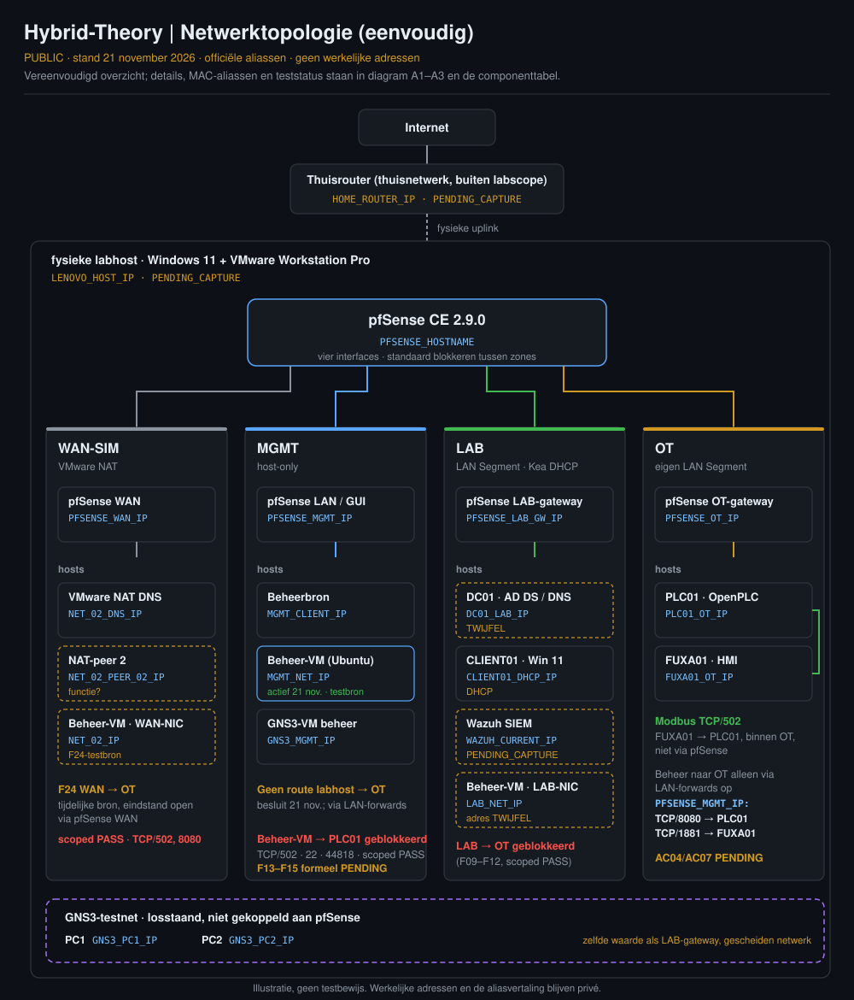
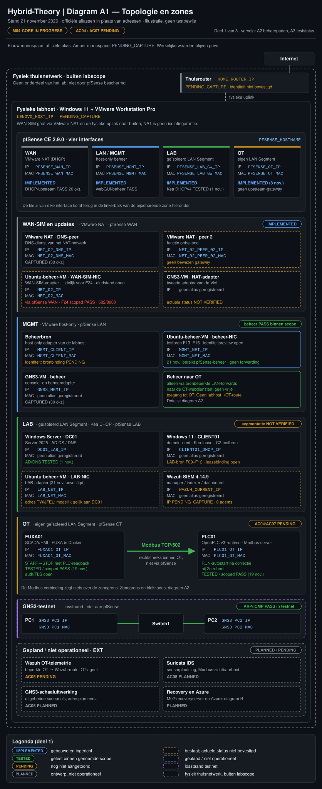
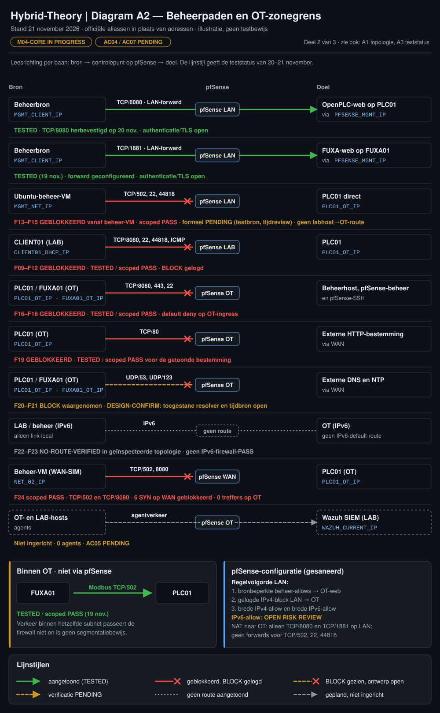
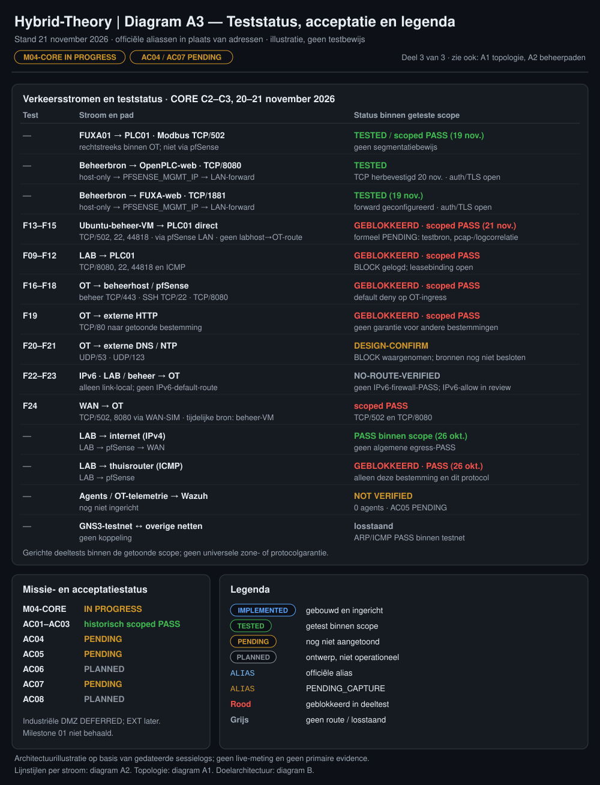
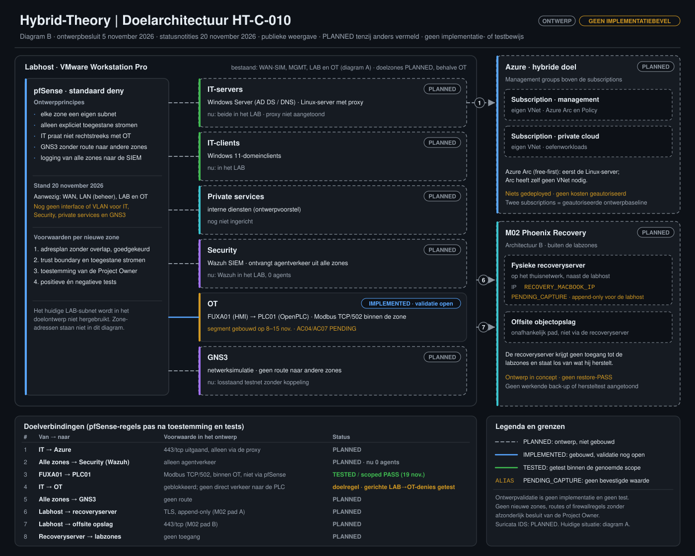

# Architectuur | Hybrid-Theory

**Bijgewerkt:** 21 november 2026 · **Bron:** private architectuur en M04-testmatrix (stand 21 november; diagram A van 15 en 20 november als momentopname bewaard; ontwerp diagram B: 5 november) · **Weergave:** gesaneerd, met officiële aliassen.

Deze map beschrijft de netwerkarchitectuur van het Hybrid-Theory-lab in twee lagen: wat er nu staat (diagram A) en waar het ontwerp naartoe gaat (diagram B). Adressen zijn vervangen door **vaste, officiële aliassen** zoals `PLC01_OT_IP`. Dezelfde alias verwijst overal naar hetzelfde adres; de werkelijke waarden en de vertaaltabel blijven privé.

## 0. In één oogopslag — eenvoudige topologie

Een vereenvoudigd overzicht voor wie snel wil zien hoe het lab is opgebouwd: één labhost, pfSense als centrale firewall en de zones MGMT, LAB en OT, plus het losstaande GNS3-testnet. Geen adressen of aliassen; voor details en teststatus zie diagram A1–A3 hieronder.

*Figuur 0.* Illustratie, geen testbewijs. [SVG](diagrammen/HT-TOPOLOGIE-EENVOUDIG-PUBLIC-2026-11-21.svg) · [PNG, hoge resolutie](diagrammen/HT-TOPOLOGIE-EENVOUDIG-PUBLIC-2026-11-21.png)

## 1. Diagram A — huidige geïmplementeerde architectuur (21 november 2026)

Diagram A bestaat uit drie delen, zodat de tekst op schermbreedte leesbaar blijft. Alle drie zijn **architectuurillustraties**, geen testbewijs en geen live-meting, en bevatten geen werkelijke adressen.

**A1 · Topologie en zones:** thuisnetwerk, labhost, pfSense-interfaces en de componenten per zone.

*Figuur 1a.* [SVG](diagrammen/HT-ARCHITECTUUR-A1-TOPOLOGIE-PUBLIC-2026-11-21.svg) · [PNG, hoge resolutie](diagrammen/HT-ARCHITECTUUR-A1-TOPOLOGIE-PUBLIC-2026-11-21.png)

**A2 · Beheerpaden en OT-zonegrens:** per verkeersstroom de bron, het controlepunt op pfSense, het doel en de teststatus van 20–21 november.

*Figuur 1b.* [SVG](diagrammen/HT-ARCHITECTUUR-A2-BEHEER-EN-ZONEGRENZEN-PUBLIC-2026-11-21.svg) · [PNG, hoge resolutie](diagrammen/HT-ARCHITECTUUR-A2-BEHEER-EN-ZONEGRENZEN-PUBLIC-2026-11-21.png)

**A3 · Teststatus, acceptatie en legenda:** tabel F09–F24, missie- en acceptatiestatus en legenda.

*Figuur 1c.* [SVG](diagrammen/HT-ARCHITECTUUR-A3-TESTSTATUS-PUBLIC-2026-11-21.svg) · [PNG, hoge resolutie](diagrammen/HT-ARCHITECTUUR-A3-TESTSTATUS-PUBLIC-2026-11-21.png) · Dezelfde inhoud in één groot overzicht: [SVG](diagrammen/HT-ARCHITECTUUR-A-HUIDIG-PUBLIC-2026-11-21.svg) · [PNG](diagrammen/HT-ARCHITECTUUR-A-HUIDIG-PUBLIC-2026-11-21.png)

**Wat de figuur laat zien:**

- **Eén VMware-host, vier netwerken achter pfSense:** WAN-SIM (VMware NAT), MGMT (host-only beheer), LAB en OT. Alle vier zijn **IMPLEMENTED**.
- **FUXA01 praat rechtstreeks met PLC01** via Modbus TCP/502. Beide staan in hetzelfde OT-subnet, dus dit verkeer loopt niet via de pfSense-router en zegt niets over de grens naar andere zones.
- **Fysieke grens:** de labhost staat in het thuisnetwerk, dat buiten de labscope valt. WAN-SIM gaat via VMware NAT en de fysieke uplink naar buiten; NAT is geen isolatiegarantie.
- **Beheerpad:** de aangewezen beheerbron bereikt via het host-only segment `PFSENSE_MGMT_IP`. Twee bronbeperkte LAN-forwards geven alleen toegang tot de OpenPLC-webdienst (TCP/8080) en de FUXA-webdienst (TCP/1881); dat is geen vrije toegang tot OT. Een directe route van de beheerhost naar `PLC01_OT_IP` koos de fysieke uplink; een geautoriseerd direct pad (F13–F15) is een ontwerpbesluit en **PENDING / DESIGN-CONFIRM**.
- **Zonegrens OT (gescopeerd, 20 november):** LAB→PLC01 (F09–F12) en OT→beheer, firewall en externe HTTP (F16–F19) zijn met gelogde blokkades **TESTED / scoped PASS**. DNS/NTP vanuit OT is geblokkeerd waargenomen, maar het ontwerp voor toegestane bronnen is **DESIGN-CONFIRM** (F20/F21). IPv6 is **NO-ROUTE-VERIFIED** binnen de geïnspecteerde topologie (F22/F23), geen IPv6-firewall-PASS. Op 21 november kreeg F24 voor TCP/502 en TCP/8080 **scoped PASS**.
- **Gepland, niet operationeel:** Wazuh OT-telemetrie (AC05 **PENDING**), Suricata IDS (AC08 **PLANNED**) en GNS3-schaaluitwerking (AC06 **PLANNED**).
- **Het GNS3-testnet staat los** van pfSense en het thuisnetwerk.
- **M04-CORE is IN PROGRESS:** AC01–AC03 historisch **scoped PASS**; AC04 (integrale segmentatie), AC05 en AC07 (volledige allow/deny-matrix) **PENDING**; AC06 en AC08 **PLANNED**.

De verkeersstromen met hun teststatus staan in [Netwerkontwerp §1.1](NETWERKONTWERP.md#11-huidige-verkeersstromen-stand-21-november-2026).

### 1.1 Componenten, zones en officiële aliassen

| Component | Zone / netwerk | IP-alias | MAC-alias | Status |
|---|---|---|---|---|
| pfSense WAN | WAN-SIM (VMware NAT) | `PFSENSE_WAN_IP` | `PFSENSE_WAN_MAC` | **IMPLEMENTED** |
| pfSense LAN / MGMT | MGMT (host-only) | `PFSENSE_MGMT_IP` | `PFSENSE_MGMT_MAC` | **IMPLEMENTED**; webbeheer PASS binnen scope |
| pfSense LAB | LAB | `PFSENSE_LAB_GW_IP` | `PFSENSE_LAB_GW_MAC` | **IMPLEMENTED**; Kea DHCPv4 TESTED (1 nov.) |
| pfSense OT | OT | `PFSENSE_OT_IP` | `PFSENSE_OT_MAC` | **IMPLEMENTED** (8 nov.); geen upstream-gateway; gelogde OT-ingressblokkades F16–F19 scoped PASS (20 nov.) |
| PLC01 (OpenPLC) | OT | `PLC01_OT_IP` | `PLC01_OT_MAC` | **IMPLEMENTED**; runtime en Modbus TCP/502 TESTED (15 nov.); RUN-autostart na correctie TESTED / scoped PASS (19 nov.) |
| FUXA01 (SCADA/HMI) | OT | `FUXA01_OT_IP` | `FUXA01_OT_MAC` | **IMPLEMENTED**; HMI en Modbus-verbinding TESTED (15 nov.); START→STOP met PLC-readback TESTED / scoped PASS (19 nov.) |
| Windows Server 2025 (DC01) | LAB | `DC01_LAB_IP` | geen alias | AD DS/DNS TESTED (1 nov.); adres **TWIJFEL** |
| Windows 11 (CLIENT01) | LAB | `CLIENT01_DHCP_IP` | geen alias | DHCP-lease; domeinclient TESTED (1 nov.); LAB-testbron F09–F12 (20 nov.), leasebinding open |
| Ubuntu(-beheer-VM), LAB-interface | LAB | `LAB_NET_IP` (IPv6: `LAB_NET_IPV6_LL`) | `LAB_NET_MAC` (PENDING_CAPTURE) | bronalias bij de LAN-proef waargenomen, identiteits- en overlapreview open |
| Ubuntu(-beheer-VM), beheerinterface | MGMT | `MGMT_NET_IP` (IPv6: `MGMT_NET_IPV6_LL`) | `MGMT_NET_MAC` (PENDING_CAPTURE) | Cockpit PASS (25 okt.); 21 nov. bereikt pfSense-beheer, testbron F13–F15; identiteitsreview **open** |
| Ubuntu(-beheer-VM), WAN-SIM-interface | WAN-SIM | `NET_02_IP` (IPv6: `NET_02_IPV6_LL`) | `NET_02_MAC` (PENDING_CAPTURE) | tijdens de managementtests los; daarna tijdelijke F24-testbron die pfSense WAN bereikt; bronalias tijdens de proef bevestigd, adaptereindstand open |
| Wazuh SIEM | LAB | `WAZUH_CURRENT_IP` (PENDING_CAPTURE) | geen alias | dashboard TESTED (3–4 nov.); 0 agents. **Ingehaald 27 nov.:** vaste adresreservering; HMI→SIEM TCP/1514 scoped PASS, zie [Netwerkontwerp, stroom 7](NETWERKONTWERP.md#11-huidige-verkeersstromen-stand-21-november-2026) |
| GNS3-VM, beheer | MGMT | `GNS3_MGMT_IP` | geen alias | beheer bereikbaar |
| GNS3 VPCS PC1 / PC2 | GNS3-testnet (losstaand) | `GNS3_PC1_IP` / `GNS3_PC2_IP` | `GNS3_PC1_MAC` / `GNS3_PC2_MAC` | ARP/ICMP PASS binnen het testnet |
| Beheerbron | MGMT | `MGMT_CLIENT_IP` | `MGMT_CLIENT_MAC` | identiteit nog te bevestigen |
| VMware NAT, DNS-peer en tweede peer | WAN-SIM | `NET_02_DNS_IP` / `NET_02_PEER_02_IP` | `NET_02_DNS_MAC` / `NET_02_PEER_02_MAC` | functie tweede peer onbekend |
| Fysieke labhost | thuisnetwerk | `LENOVO_HOST_IP` (PENDING_CAPTURE) | geen alias | — |
| Thuisrouter | thuisnetwerk | `HOME_ROUTER_IP` (PENDING_CAPTURE) | geen alias | identiteit niet bevestigd |
| Recoveryserver (M02) | thuisnetwerk | `RECOVERY_MACBOOK_IP` (PENDING_CAPTURE) | geen alias | **PLANNED** |

**Leesregels:**

- De tabel bevat alleen aliasnamen. **PENDING_CAPTURE** betekent dat er geen bevestigde waarde is; er is niets ingevuld of geschat. Waar "geen alias" staat, bestaat geen officiële alias.
- **TWIJFEL:** `LAB_NET_IP` en `DC01_LAB_IP` zijn op verschillende meetdatums met dezelfde waarde vastgelegd. Gelijktijdig gebruik is niet aangetoond; dit is geen bewezen conflict.
- `PFSENSE_LAB_GW_IP` en `GNS3_PC1_IP` hebben dezelfde waarde in **gescheiden netwerken**. Dat wordt pas een conflict als die netwerken worden gekoppeld.
- `PLC01_TEMP_NAT_IP` en `FUXA_TEMP_NAT_IP` zijn **historische** adressen van vóór de OT-migratie en geen actuele endpoints.
- **TESTED** betekent: getest binnen de genoemde scope en vastgelegd in een gedateerd log. De primaire evidence is niet gepubliceerd.

## 2. Diagram B — doelarchitectuur HT-C-010

*Figuur 2. **Ontwerpillustratie** van de op 5 november 2026 door Sam gevalideerde doelarchitectuur (HT-C-010). Dit is een ontwerpbesluit, geen implementatie en geen test.*

**Beoordeling 20 november:** de CORE C2-resultaten veranderen het onderscheid tussen AS-IS en TO-BE niet. Er zijn geen nieuwe zones, routes of Azure-resources geïmplementeerd. Alleen drie statusnotities in de figuur zijn geactualiseerd (peildatum, de FUXA01→PLC01-deeltest van 19 november en de gerichte LAB→OT-denies); het ontwerp zelf is ongewijzigd.

- **Bestaande netwerken (diagram A):** WAN-SIM, MGMT, LAB en OT zijn **IMPLEMENTED**.
- **HT-C-010-doelzones:** van de zes doelzones bestaat alleen OT al als eigen segment. IT-servers, IT-clients, Security, private services en GNS3 zijn als afzonderlijke zones **PLANNED**; hun systemen staan nu in het LAB of in het losstaande GNS3-testnet.
- **Azure:** de ontwerpbaseline bevat **twee** voorgestelde subscriptions, elk met een eigen VNet. Niets is gedeployed. **PLANNED.**
- **M02 Phoenix Recovery:** recoveryserver buiten de labzones en een onafhankelijk offsite-pad. Geen restore getest. **PLANNED.**

De doelverbindingen staan in [Netwerkontwerp §2](NETWERKONTWERP.md#2-ht-c-010-doelarchitectuur-en-toekomstige-netwerkgrenzen).

## 3. Huidige en geplande onderdelen

| Onderdeel | Bewezen basis | Doel / resterende validatie |
|---|---|---|
| VMware en pfSense | Host met meerdere VM's; pfSense met vier interfaces (WAN, MGMT, LAB, OT); gerichte LAB-, DHCP- en firewallproeven | Integrale segmentatie (AC04) en volledige allow/deny-matrix (AC07) |
| Windows Server en Windows 11 | AD DS, DNS/SRV, domain join, testlogin en GPO binnen afgebakende scope | Hardening, redundantie en herstelbaarheid |
| Ubuntu en Cockpit | Linuxbeheer en beperkte beheertoegang getest | Actuele interfacestatus, private services, optionele Azure Arc-agent |
| Wazuh SIEM | Manager/indexer/dashboard gestart, dashboardlogin bereikt | Actieve agentverbinding, agentingestie, detectie en een eigen Security-zone (vóór P3 0 geregistreerde remote agents) |
| GNS3 en Wireshark | Gescheiden VPCS-switch-test met ARP/ICMP | Uitgebreid netwerk, isolatie en routevalidatie |
| FUXA01 en PLC01 (OT) | Beide in OT; na correctie start OpenPLC bij een tweede PLC01-reboot automatisch in RUN-modus; FUXA herverbindt en een START→STOP-cyclus met PLC-readback is op 19 november **TESTED / scoped PASS** | Formele eigenaarreview AC01–AC03, authenticatie/TLS, integrale OT-segmentatie (AC04/AC07) en hersteltest |
| Phoenix Recovery M02 | Architectuur B ontworpen | Onafhankelijke recoveryhost, offsite en restoretest |
| Azure / Entra / Arc | Architectuurvoorstel | Twee afzonderlijke subscriptions/VNets, kostenreview en deployment |

**Bewijsregel:** een geïnstalleerde VM of werkend dashboard is niet automatisch een voltooide securitycontrole. Losse tests gelden alleen binnen hun gedocumenteerde scope.

## 4. Netwerkgrenzen en onzekerheid

De bestaande netwerken WAN-SIM, MGMT, LAB en OT worden uitdrukkelijk **gescheiden** van de geplande IT-, Security-, private-services- en GNS3-zones. De OT-zone is gebouwd, maar haar isolatie is **niet bewezen** zolang AC04 en AC07 openstaan. Een geslaagde verbinding binnen OT is geen bewijs van afscherming naar andere zones.

[Netwerkontwerp](NETWERKONTWERP.md) beschrijft de huidige stromen, de doelverbindingen en de openstaande verificaties. De figuren bevatten geen werkelijke adressen, geen firewall- of NAT-configuratie en geen beheerdetails.

## 4.1. Regressie- en firewallobservaties (19–20 november 2026)

In de private M04-engineeringlogs is een eerste mislukte PLC-autostart vastgelegd, gevolgd door een instellingcorrectie en een geslaagde tweede reboot. FUXA herstelde de Modbus-verbinding en de HMI START→STOP-reeks bereikte de verwachte PLC-statussen (**TESTED / scoped PASS**, formele bewijsreview open). Gerichte LAB→OT-, OT→LAB- en OT→externe-bestemming-blokkeringen zijn met firewalllogs gecorreleerd; beperkt beheer-TCP-bereik is positief getest. Dit zijn geen bewijzen voor alle denkbare paden.

**Openstaande architectuurrisico's:** brede LAN IPv4-/IPv6-allowregels, NAT-/beheeruitzonderingen, IPv6 en alternatieve routes, UDP-egress, verificatie van configuratieback-up en herstelbaarheid. De verkorte testwerkwijze van 20 november verandert de acceptatie-eisen **niet**. [Fase-20-evidence](../Labs/M04-Network-Citadel/M04-Bewijsvoering/20_OT_segmentation_and_regression/README.md) · [Netwerkontwerp](NETWERKONTWERP.md).

Diagram A heeft peildatum 21 november en verwerkt de CORE C2-deeltests en de C3-managementtests als gescopeerde status. De figuur is **geen live-testmeting** en geen primaire evidence.

## 5. Historische figuren

De [publieke figuur van 5 november 2026](diagrammen/HT-NETWERKARCHITECTUUR-PUBLIC-2026-11-05.svg) blijft als historische weergave bewaard. Ze dateert van vóór de OT-migratie, toont OpenPLC nog als gepland en gebruikt aliasnamen die niet de officiële zijn.

De versies van 15 november, [diagram A](diagrammen/HT-ARCHITECTUUR-A-HUIDIG-PUBLIC-2026-11-15.svg) en [diagram B](diagrammen/HT-ARCHITECTUUR-B-DOELONTWERP-PUBLIC-2026-11-15.svg), blijven ongewijzigd bewaard als gedateerde weergave van die stand. De versie van diagram A van 20 november ([overzicht](diagrammen/HT-ARCHITECTUUR-A-HUIDIG-PUBLIC-2026-11-20.svg), [A1](diagrammen/HT-ARCHITECTUUR-A1-TOPOLOGIE-PUBLIC-2026-11-20.svg), [A2](diagrammen/HT-ARCHITECTUUR-A2-BEHEER-EN-ZONEGRENZEN-PUBLIC-2026-11-20.svg), [A3](diagrammen/HT-ARCHITECTUUR-A3-TESTSTATUS-PUBLIC-2026-11-20.svg), [eenvoudig](diagrammen/HT-TOPOLOGIE-EENVOUDIG-PUBLIC-2026-11-20.svg)) blijft eveneens als momentopname bewaard. Gebruik voor de actuele situatie diagram A van 21 november en diagram B van 20 november.

## 6. Documentatie en governance

- [Architectuurbaseline / CAT/ACE v0.4](ARCHITECTUUR_BASELINE.md)
- [Netwerkontwerp en trust boundaries](NETWERKONTWERP.md)
- [pfSense-plan](PFSENSE_PLAN.md)
- [Linux/Cockpit](LINUX_COCKPIT_SERVICE.md)
- [Azure free-first doelontwerp](VOORBEELDMODEL-HYBRIDE-TOPOLOGIE-AZURE-GRATIS.md)
- [M02 Phoenix Recovery](../Governance/M02-Phoenix-Recovery/README.md)

**Publicatiegrens:** deze figuren en tabellen zijn gesaneerd; een volledige review van repo-historie, issues en alle artifacts blijft een aparte controle. Zie het [publicatiebeleid](../Governance/PUBLICATIEBELEID.md).

## M04-netwerkdelta — 20 november

[AS-IS netwerkpaden](NETWERKONTWERP.md#m04-as-is--netwerkpaden-beoordeeld-op-20-november) · [pfSense-review](PFSENSE_PLAN.md#m04--configuratiereview-en-deeltests-op-20-november) · [Gescopeerde C2-testronde](../Projectlogboeken/2026-11-20-m04-core-c2-netwerkvalidatie.md). De netwerkdelta geeft de getoonde beheer-, LAB-, OT-, IPv6- en WAN-scope weer en is verwerkt in [diagram A van 20 november](diagrammen/HT-ARCHITECTUUR-A-HUIDIG-PUBLIC-2026-11-20.svg).

## Statusdelta 21 november 2026 — beheernetwerk en OT

Volgens de eigenaarsessie blokkeerde pfSense drie directe management→PLC-pogingen op TCP/502, TCP/22 en TCP/44818. Dit is **TESTED / scoped PASS voor de werkelijk gebruikte virtuele beheerbron**, niet de formele acceptatie van F13–F15 of AC04/AC07. De LAN-route is verwijderd. Formele bronacceptatie en tijdreview per poort staan open. **F24 · scoped PASS voor TCP/502 en TCP/8080.** pfSense ontving zes SYN-pakketten op de gesimuleerde WAN-grens, drie per doelpoort. De IPv4-default-deny blokkeerde ze alle zes. De gelijktijdige, op bron, doel en beide poorten gefilterde OT-capture bevat nul pakketten.

De afbeeldingen op deze pagina tonen de **topologie en teststand van 21 november**, inclusief de C3-resultaten uit het [gesaneerde sessielog van 21 november](../Projectlogboeken/2026-11-21-m04-core-management-segmentatie.md). Geen directe permanente fysieke-host→OT-route of industriële DMZ in deze fase.

## AC05 P3/P4 · actuele tussenstand 27 november

**P3/P4 TESTED / scoped PASS:** één HMI-agent is op de Wazuh-manager geregistreerd en offline vanaf een read-only ISO geïnstalleerd. De pakketstatus is installed; de agentservice is inactive. Sleutelimport, actieve verbinding, eventingestie en FIM blijven **PENDING**. AC05 integraal **PENDING**. [Uitvoeringslog](../Projectlogboeken/2026-11-27-m04-ac05-p3-p4-offline-agentinstallatie.md). De eerdere nul-agentstand is historisch.
