# M04 fase 22 · LAN- en WAN-proeven naar OT

**21 november 2026 · 38 gesaneerde screenshots en één OT-pcap.** M04-CORE is in uitvoering. Milestone 01 en de integrale acceptatie van AC04/AC07 staan open.

[Missiedossier](../../README.md) · [Galerij per fase](../../M04-GALERIJ.md) · [Daglog](../../../../projectlogboeken/2026-11-21-m04-core-management-segmentatie.md) · [CSV-manifest](M04-EVIDENCE-PHASE22.csv) · [SHA-256](SHA256SUMS.txt) · [Saneringsrapport](M04-PHASE22-SANITIZATION-REPORT.md)

| Vraag | Bewijs |
|---|---|
| Welke LAN-probes zijn geblokkeerd? | [TCP/502-client](01-LAN/09-beheer-vm-probe-tcp-502.png) en [LAN-log](01-LAN/10-pfsense-bloklog-tcp-502.png), [TCP/22 en TCP/44818](01-LAN/12-beheer-vm-probes-tcp-22-en-44818.png) en [gecombineerd bloklog](01-LAN/13-pfsense-bloklog-alle-drie-poorten.png). [Gefilterde OT-eindtellers voor TCP/22 en TCP/44818](02-LAN-WAN/01-lan-ot-capture-eindtellers.png). |
| Wat toont de WAN-eindmeting? | [Clientuitvoer](02-LAN-WAN/17-f24-client-eindmeting.png), [zes SYN op WAN](02-LAN-WAN/21-f24-wan-capture-eindmeting-zes-syn.png), [drie blokkades op TCP/502](02-LAN-WAN/22-f24-bloklog-eindmeting-tcp-502.png) en [drie blokkades op TCP/8080](02-LAN-WAN/23-f24-bloklog-eindmeting-tcp-8080.png). [OT-capture actief na de probes](02-LAN-WAN/19-f24-ot-capture-na-probes-actief.png) · [gestopte capture](02-LAN-WAN/20-f24-ot-capture-eindmeting-gestopt.png) · [OT-pcap van 24 bytes](02-LAN-WAN/F24-OT-EINDMETING.pcap). |
| Is het testpad opgeruimd? | [LAN-hostroute verwijderd](02-LAN-WAN/02-lan-rollback-routecontrole.png), [WAN-hostroute verwijderd](02-LAN-WAN/24-f24-rollback-wan-hostroute.png) en [Host-only-beheer bereikbaar](02-LAN-WAN/25-f24-cockpit-beheerpad-hersteld.png). De adapterbeelden vóór F24 tonen de uitgangsstand. De verbindingsstatus van de virtuele adapters na afloop vraagt nog afzonderlijk bewijs. |

F13–F15 hebben scoped PASS vanaf de gebruikte beheer-VM. De OT-eindtellers gelden voor TCP/22 en TCP/44818. Voor TCP/502 is afzonderlijk LAN-blokbewijs beschikbaar. De formele bronacceptatie en tijdreview per poort staan open.

F24 heeft scoped PASS voor TCP/502 en TCP/8080. In de eindmeting kwamen zes SYN-pakketten op WAN aan. De IPv4-default-deny blokkeerde alle zes en de gelijktijdige gefilterde OT-capture bevat nul packetrecords.

De volgnummers links in de galerij volgen de twee aangeleverde reeksen. Deel 1 bevat 13 opnamen en deel 2 bevat 25 opnamen. De bestandsbeschrijvingen gebruiken de nummering binnen elk deel. [Beschrijving deel 1](01-LAN/BESCHRIJVINGEN.txt) · [Beschrijving deel 2](02-LAN-WAN/BESCHRIJVINGEN.txt)

## Deel 1 · LAN-proeven vanaf de beheer-VM

### M04-20261121-001 · beheerhost route naar plc01

**Deel 1, beeld 01 · F13–F15 · TEST.** Op de beheerhost laat Find-NetRoute voor PLC01 (PLC01_OT_IP) de Wi-Fi-standaardroute zien, met bron REDACTED_WIFI_IP en gateway HOME_ROUTER_IP. Dit verklaart waarom een directe probe vanaf de beheerhost op dat moment niet via het bedoelde pfSense-beheerpad zou lopen. Dit is een routecontrole.

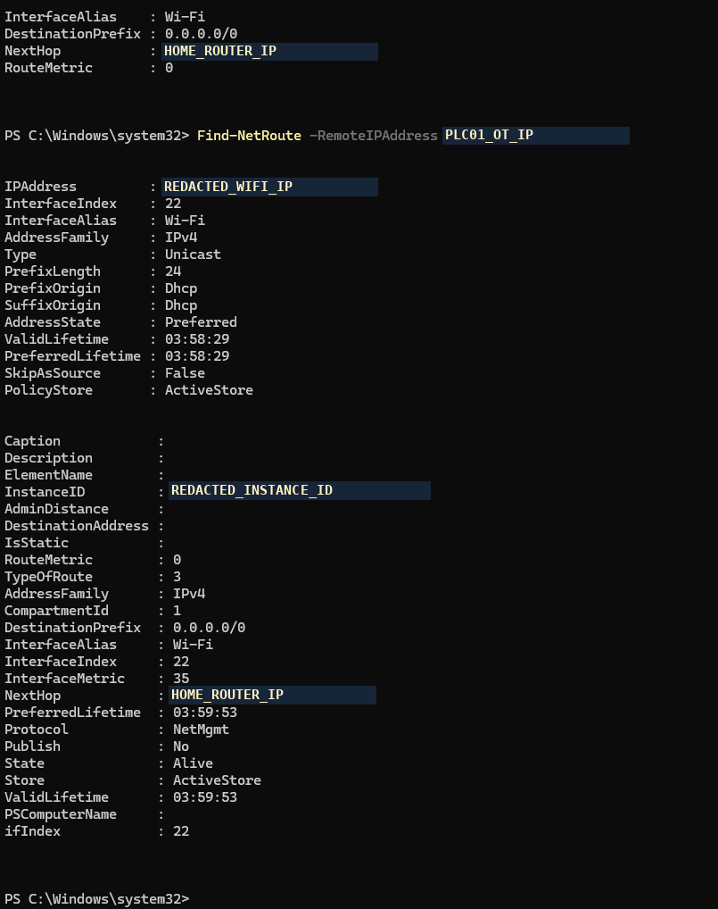

### M04-20261121-002 · beheerhost route naar pfsense

**Deel 1, beeld 02 · F13–F15 · TEST.** Op de beheerhost laat Find-NetRoute voor pfSense LAN (PFSENSE_MGMT_IP) VMware VMnet1 zien, met bron MGMT_CLIENT_IP in REDACTED_MGMT_SUBNET (/24). Het toont de gekozen interface voor het beheeradres. De routecontrole bevat geen end-to-end bevestiging van een portforward.

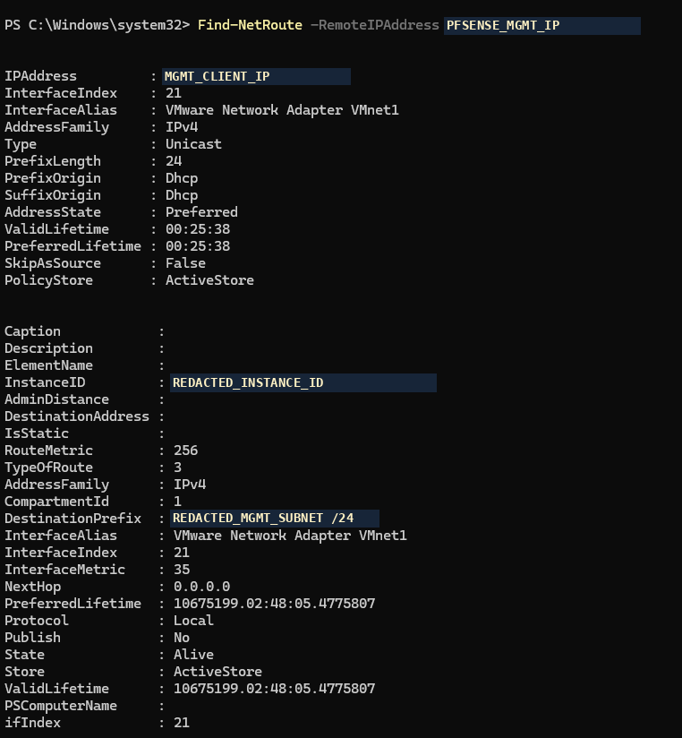

### M04-20261121-003 · pfsense lan regels

**Deel 1, beeld 03 · F13–F15 · CONFIG.** De LAN-regellijst toont brongebonden IPv4-beheeruitzonderingen voor FUXA01 op TCP/1881 en PLC01 op TCP/8080, boven M04 LAN -> OT default deny voor REDACTED_OT_SUBNET (/24). De algemene LAN-allow voor IPv6 is zichtbaar en staat ter beoordeling. Dit beeld toont de relevante uitsnede van de configuratie. De werking van de blokregel blijkt uit screenshots 10 en 13.

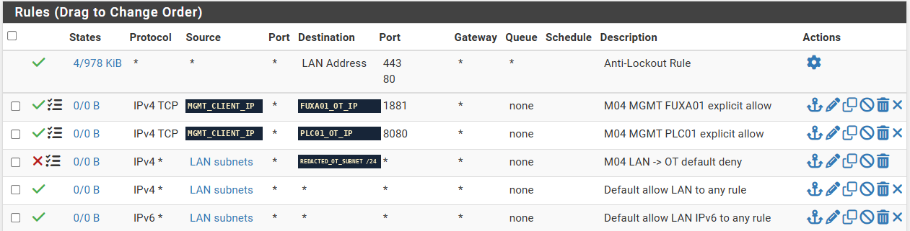

### M04-20261121-004 · plc01 adres en lokale route

**Deel 1, beeld 04 · F13–F15 · TEST.** De console van PLC01 toont een routequery naar het eigen adres PLC01_OT_IP. De uitvoer bevat dev lo en cache <local>. Dit bevestigt waarom PLC01 zelf als bron geen LAN→OT-proef oplevert.

### M04-20261121-005 · beheer vm host only adapter

**Deel 1, beeld 05 · F13–F15 · CONFIG.** De VMware-instellingen tonen dat Network Adapter 3 van de beheer-VM op Host-only staat. Connected en Connect at power on zijn op dit beeld uitgevinkt. Dit is een momentopname voorafgaand aan de latere routecontrole via ens38.

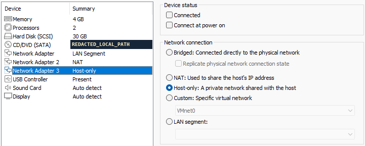

### M04-20261121-006 · beheer vm nat adapter

**Deel 1, beeld 06 · F13–F15 · CONFIG.** Network Adapter 2 staat in VMware op NAT. Connected en Connect at power on zijn op dit beeld uitgevinkt. Het screenshot legt de status van deze adapter op het opnamemoment vast.

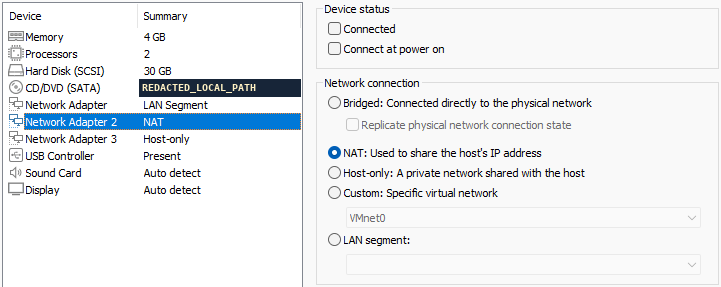

### M04-20261121-007 · beheer vm lan segment

**Deel 1, beeld 07 · F13–F15 · CONFIG.** De eerste VMware-netwerkadapter staat op het LAN-segment REDACTED_LAN_SEGMENT. Connected en Connect at power on zijn aangevinkt.

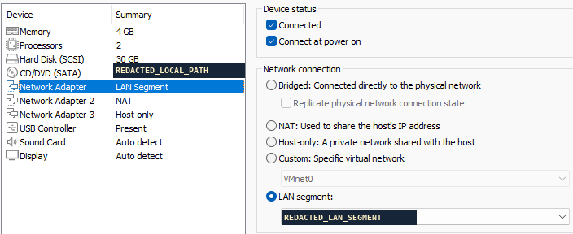

### M04-20261121-008 · beheer vm tijdelijke testroute

**Deel 1, beeld 08 · F13–F15 · TEST.** De beheer-VM ziet ens33 (LAB_NET_IP/24) en ens38 (MGMT_NET_IP/24). PLC01 heeft aanvankelijk geen route. De ping via ens38 naar pfSense LAN slaagt. Daarna wordt een tijdelijke hostroute voor PLC01_OT_IP/32 toegevoegd via PFSENSE_MGMT_IP en controleert ip route get de gekozen interface en bron.

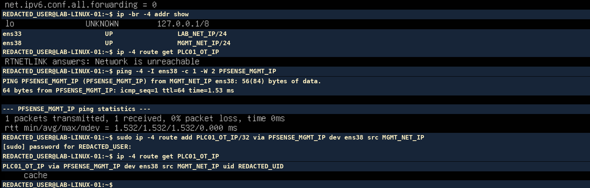

### M04-20261121-009 · beheer vm probe tcp 502

**Deel 1, beeld 09 · F13 · TEST.** De beheer-VM voert om 17:04:34 CET een TCP/502-probe uit vanaf MGMT_NET_IP naar PLC01. De client meldt een timeout. Dezelfde terminal toont de tijdelijke /32-route en de eerdere controles waarop IPv4-en IPv6-forwarding op de beheer-VM uit staan. Screenshot 10 koppelt de timeout aan de pfSense-blokregel.

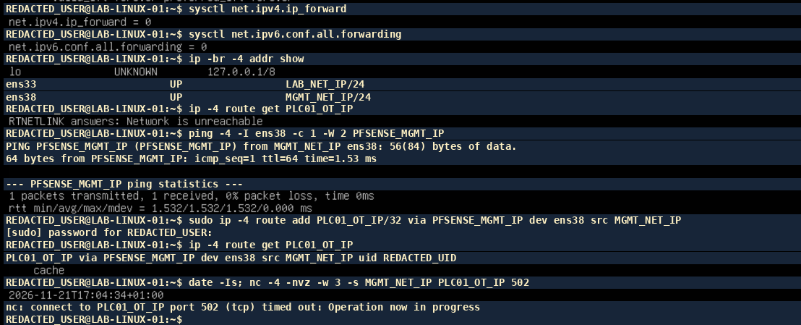

### M04-20261121-010 · pfsense bloklog tcp 502

**Deel 1, beeld 10 · F13 · LOG.** PfSense registreert op LAN drie geblokkeerde TCP SYN-pakketten van MGMT_NET_IP:SRC_A naar PLC01_OT_IP:502, van 17:04:34 tot 17:04:36 CET. Alle regels matchen M04 LAN -> OT default deny (trackeralias RULE_A). Dit is het afzonderlijke firewallbewijs voor TCP/502.

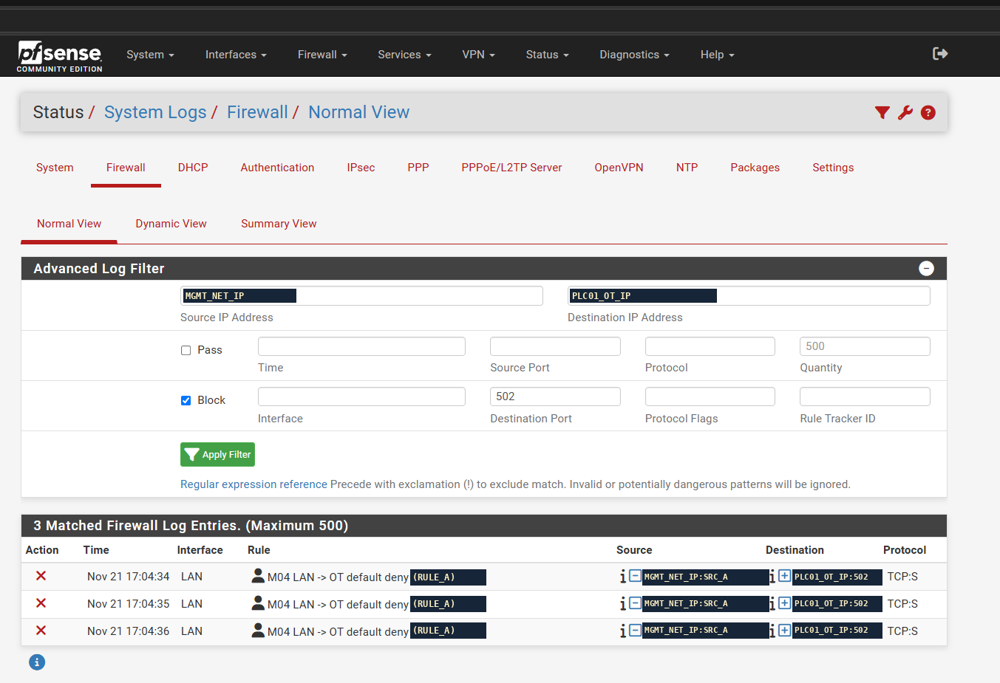

### M04-20261121-011 · pfsense ot capture start

**Deel 1, beeld 11 · F14/F15 · TEST.** De pfSense-shell toont de start van een gefilterde capture op OT-interface em3 voor de beheer-VM→PLC01 op TCP/22 en TCP/44818. De teller van 1772 pakketten erboven hoort bij een eerder gestopte capture met zichtbaar FUXA01→PLC01-verkeer op TCP/502. De eindteller van de nieuwe capture ontbreekt.

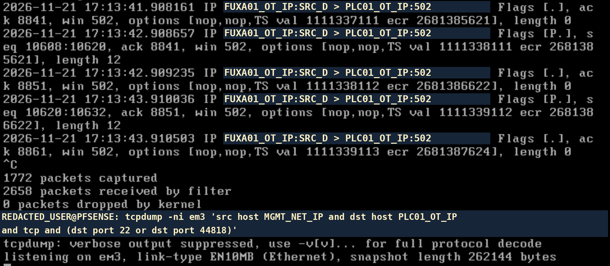

### M04-20261121-012 · beheer vm probes tcp 22 en 44818

**Deel 1, beeld 12 · F14/F15 · TEST.** De Cockpit-terminal draait op LAB-LINUX-01 (testrol beheer-VM). De routequery bevestigt PFSENSE_MGMT_IP als next hop, ens38 als interface en MGMT_NET_IP als bron. Beide TCP-probes lopen in een timeout. De getoonde clienttijd direct vóór de opdracht is 17:43:35 CET voor TCP/22 en 17:43:38 CET voor TCP/44818.

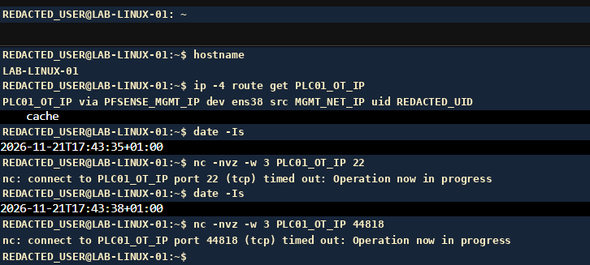

### M04-20261121-013 · pfsense bloklog alle drie poorten

**Deel 1, beeld 13 · F13–F15 · LOG.** De gecombineerde logweergave toont negen geblokkeerde SYN-pakketten op LAN onder trackeralias RULE_A. Per bestemming zijn dit drie regels: TCP/502 om 17:04:34–17:04:36 (bronpoort SRC_A), TCP/22 om 17:43:35–17:43:37 (SRC_B), en TCP/44818 om 17:43:42–17:43:44 (SRC_C). De herhaalde bronpoort per bestemming past bij hertransmissies van dezelfde verbindingspoging.

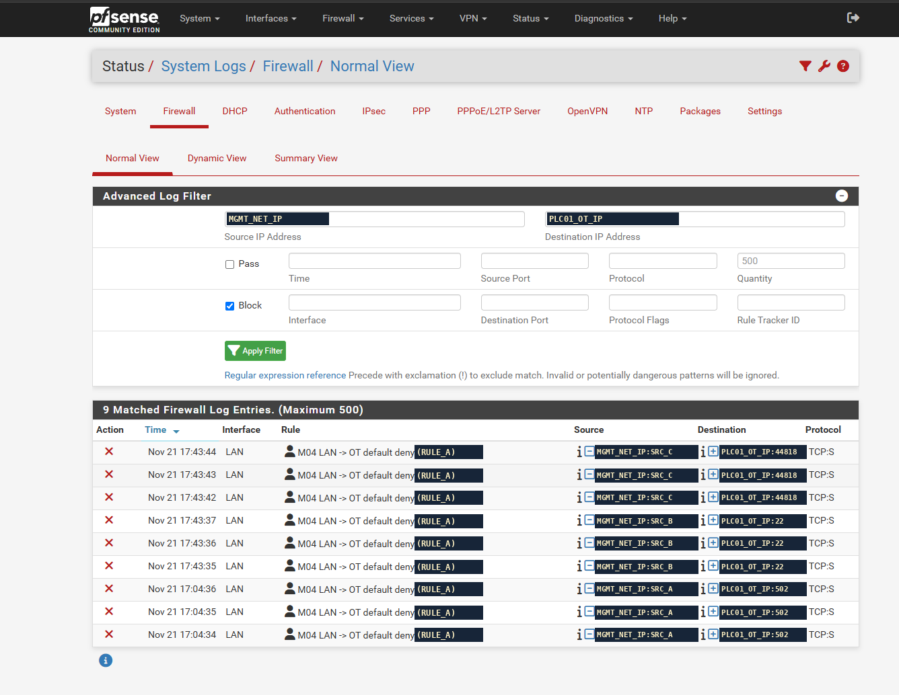

## Deel 2 · LAN-cleanup en WAN-proef

### M04-20261121-014 · lan ot capture eindtellers

**Deel 2, beeld 01 · F14/F15 · TEST.** De pfSense-shell toont twee gestopte captures op OT (em3) met een filter voor beheerbron MGMT_NET_IP, PLC01-doel PLC01_OT_IP en TCP/22 of TCP/44818. Beide tonen nul passende pakketten en nul kernel-drops. Deze eindtellers ondersteunen F14/F15 in samenhang met de eerder opgeslagen LAN-bloklogs. De ruimere capture met 1772 pakketten erboven is een eerdere sessie. TCP/502 valt buiten de getoonde smalle filters.

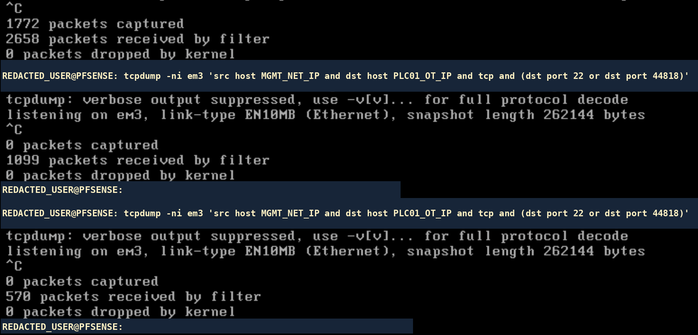

### M04-20261121-015 · lan rollback routecontrole

**Deel 2, beeld 02 · F13–F15 · TEST.** Cockpit-terminal van de beheer-VM na verwijdering van de tijdelijke LAN-route via PFSENSE_MGMT_IP op ens38. Herhaalde verwijdering geeft No such process. De twee afzonderlijke route-lookups eindigen in Network is unreachable, gelijk aan de uitgangssituatie voor dit doel.

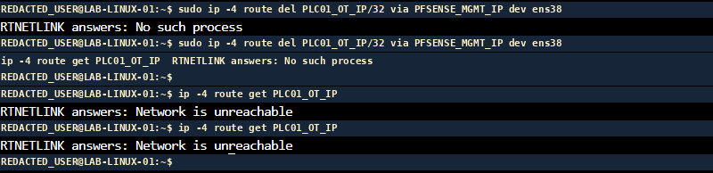

### M04-20261121-016 · pfsense interfaceoverzicht

**Deel 2, beeld 03 · F24 · CONFIG.** Status van pfSense met WAN em1 op PFSENSE_WAN_IP/24, LAN em0 op PFSENSE_MGMT_IP/24, LAB em2 op PFSENSE_LAB_GW_IP/24 en OT em3 op PFSENSE_OT_IP/24. Dit bindt het WAN-next-hop-adres en beide capture-interfaces aan de F24-opstelling.

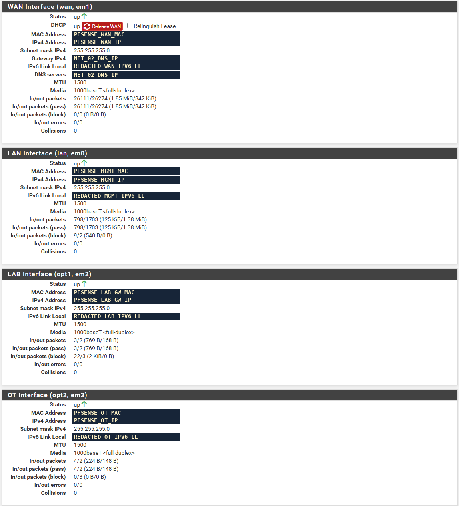

### M04-20261121-017 · beheer vm vmware lan uitgangsstand

**Deel 2, beeld 04 · F24 · CONFIG.** Voor F24 is Network Adapter van de beheer-VM aan het VMware LAN Segment REDACTED_LAN_SEGMENT gekoppeld. Connected en Connect at power on staan aan. Dit beeld legt de uitgangsstand vast.

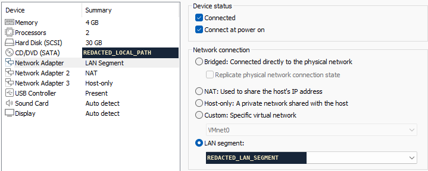

### M04-20261121-018 · beheer vm vmware nat uitgangsstand

**Deel 2, beeld 05 · F24 · CONFIG.** Network Adapter 2 van de beheer-VM is Network Address Translation (NAT). Connected en Connect at power on staan uit in deze uitgangsstand. Deze bestaande adapter is later tijdelijk gebruikt als bron op het gesimuleerde WAN.

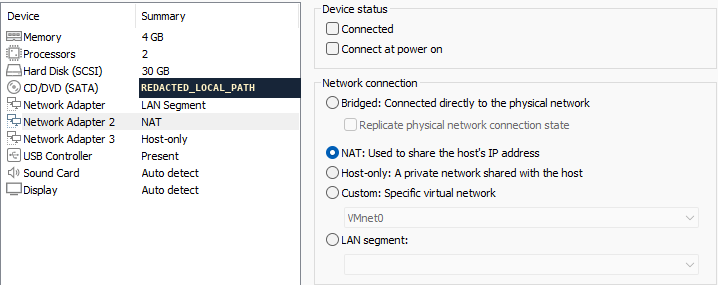

### M04-20261121-019 · beheer vm vmware host only uitgangsstand

**Deel 2, beeld 06 · F24 · CONFIG.** Network Adapter 3 van de beheer-VM staat op Host-only. Connected staat aan en Connect at power on staat uit. Dit is de uitgangsstand van de beheeradapter vóór de WAN-proef.

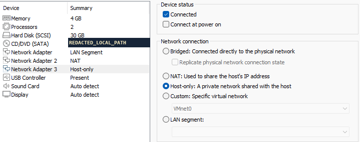

### M04-20261121-020 · f24 wan bron en next hop

**Deel 2, beeld 07 · F24 · TEST.** De beheer-VM heeft op ens37 het IPv4-adres NET_02_IP/24. De routecontrole naar pfSense WAN PFSENSE_WAN_IP kiest direct ens37 en het verwachte bronadres.

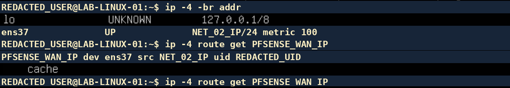

### M04-20261121-021 · f24 tijdelijke wan hostroute

**Deel 2, beeld 08 · F24 · TEST.** De tijdelijke IPv4-hostroute naar PLC01 is aangelegd op de beheer-VM. De routequery bevestigt PLC01_OT_IP via PFSENSE_WAN_IP op ens37 met NET_02_IP als bron. Dit is de opstelling voor de rechtstreekse WAN→OT-probes.

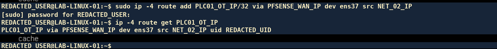

### M04-20261121-022 · f24 ot filterconfiguratie

**Deel 2, beeld 09 · F24 · CONFIG.** Vóór de capture toont de pfSense-webinterface OT (em3) en het filter voor ongetagd verkeer tussen NET_02_IP en PLC01_OT_IP op TCP/502 of TCP/8080. Het filter is bedoeld voor de F24-verkeersstroom.

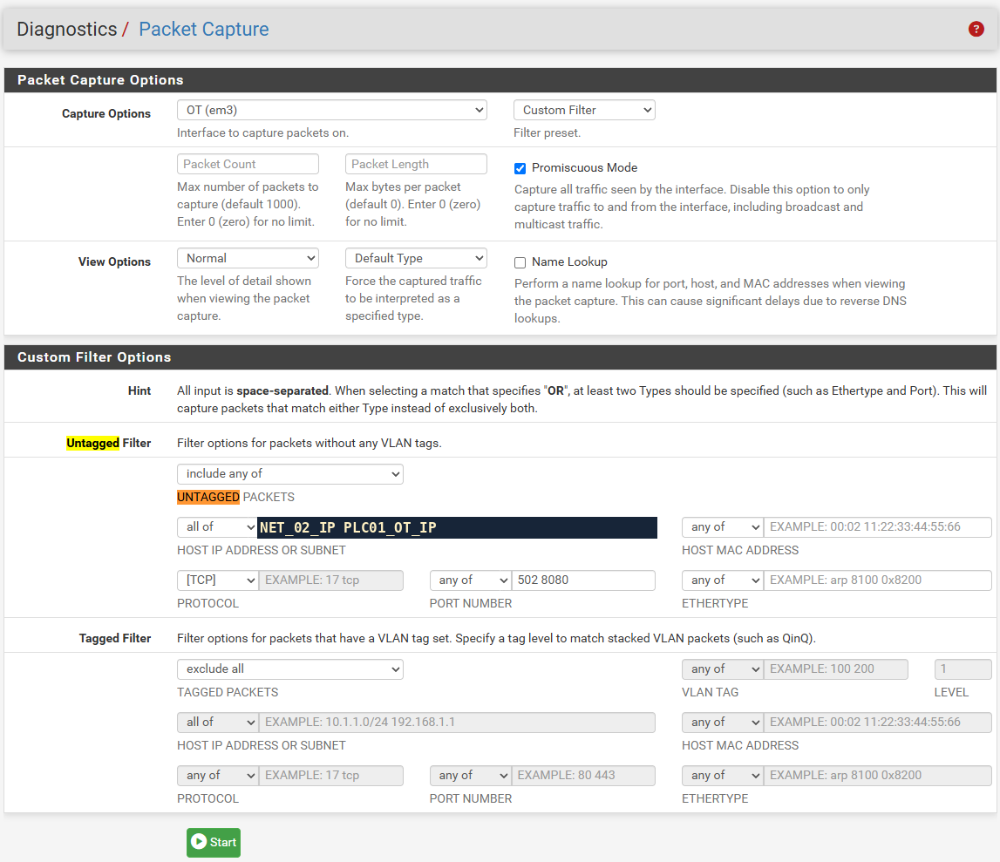

### M04-20261121-023 · f24 client eerste wan ronde

**Deel 2, beeld 10 · F24 · TEST.** De beheer-VM toont de eerste timeouts op TCP/502 en TCP/8080 met bron NET_02_IP. De tijdcommando’s en probes staan hier op afzonderlijke regels. Gebruik de tijden en bronpoorten uit de WAN-capture voor de precieze firewalllog-correlatie.

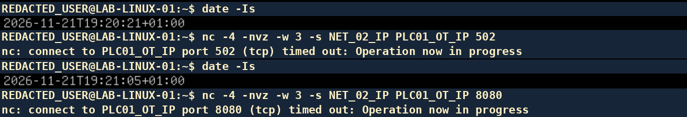

### M04-20261121-024 · f24 wan ingress eerste ronde

**Deel 2, beeld 11 · F24 · TEST.** De eerste WAN-capture op em1 toont drie SYN-pakketten per doelpoort vanaf de beheer-VM. TCP/502 gebruikt bronpoort WAN_SRC_01 rond 19:20:52–19:20:54. TCP/8080 gebruikt bronpoort WAN_SRC_02 rond 19:21:21–19:21:23. Hiermee is aankomst op pfSense aangetoond.

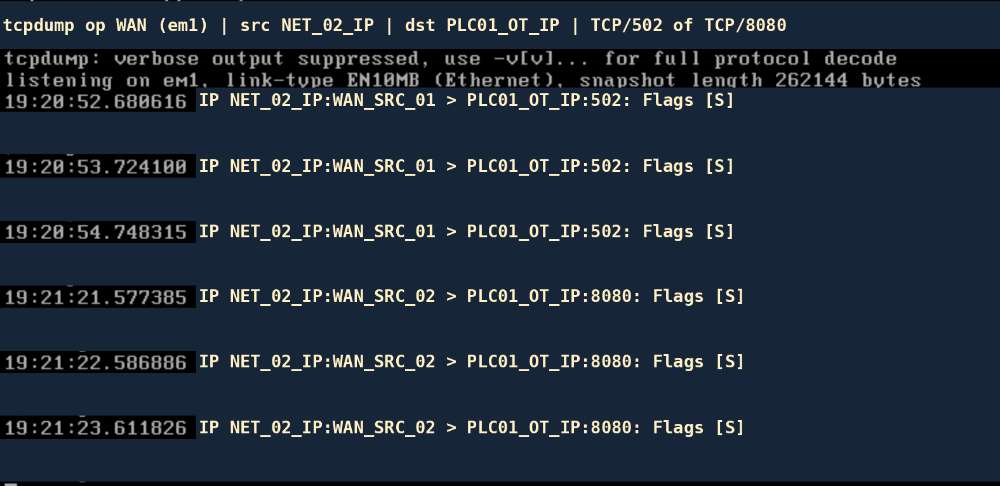

### M04-20261121-025 · f24 ot capture eerste poging actief

**Deel 2, beeld 12 · F24 · TEST.** De webinterface toont de actieve OT-capture F24-OT-EERSTE-POGING.pcap, gestart na de eerste WAN-probes. Het uitvoerveld is leeg. Dit beeld kan de eerste ronde niet afdekken.

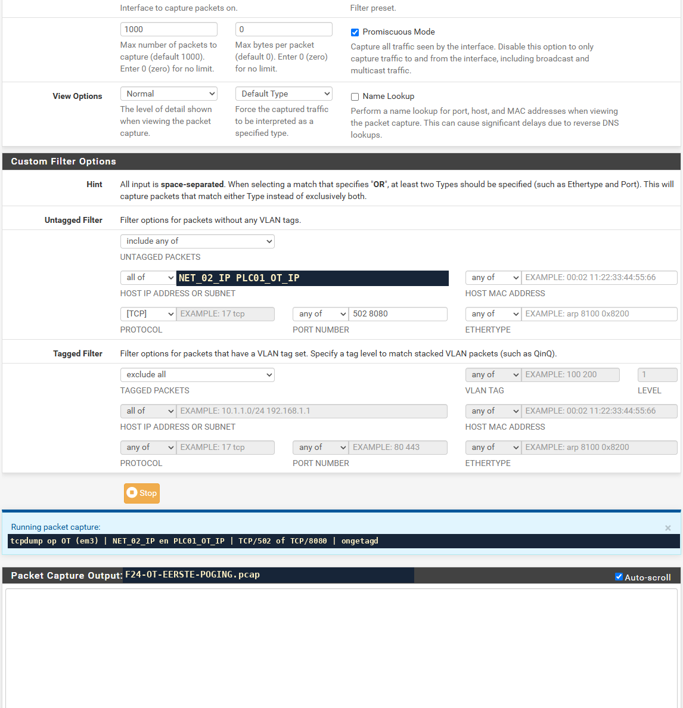

### M04-20261121-026 · f24 client wan herhaling

**Deel 2, beeld 13 · F24 · TEST.** De herhaalde probes worden samen met hun begintijd getoond. TCP/502 bij 19:25:17 en TCP/8080 bij 19:25:33 geven beide een timeout. Beide gebruiken de beheer-VM NET_02_IP als expliciete bron.

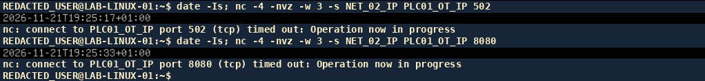

### M04-20261121-027 · f24 wan ingress herhaling

**Deel 2, beeld 14 · F24 · TEST.** WAN em1 toont drie SYN-pakketten per poort voor de herhaling, bronpoort WAN_SRC_03 voor TCP/502 en WAN_SRC_04 voor TCP/8080. De eindteller van twaalf omvat ook de eerste ronde op dezelfde capture.

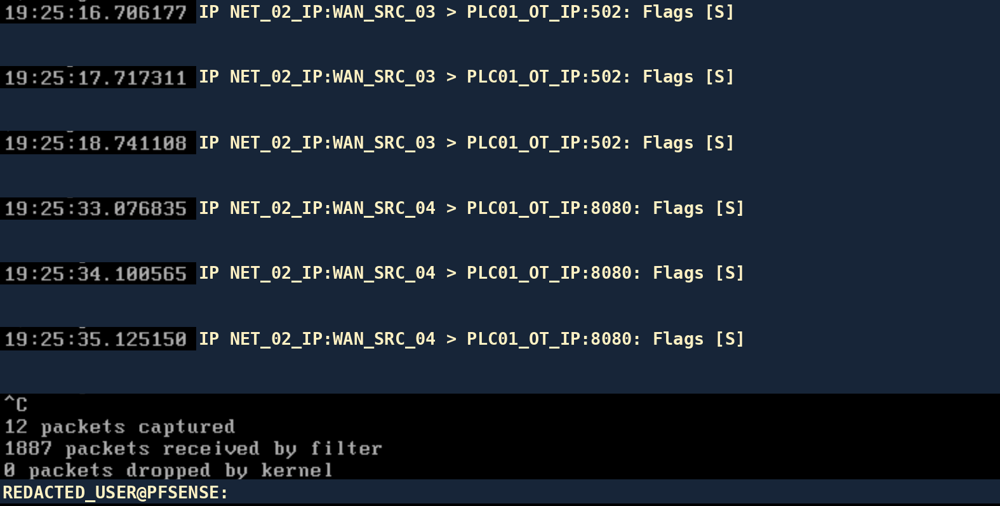

### M04-20261121-028 · f24 ot capture eerste poging gestopt

**Deel 2, beeld 15 · F24 · TEST.** Bij het stoppen van de oudere OT-capture toont de webinterface dezelfde start-en stoptijd, 19:22:49, en een leeg uitvoerveld. Die tijdweergave bevestigt geen dekking van de herhaling om 19:25. De eindmeting gebruikt een andere capture.

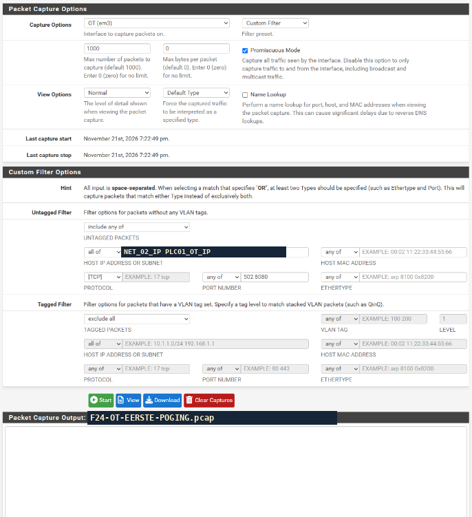

### M04-20261121-029 · f24 wan bloklogs eerste twee rondes

**Deel 2, beeld 16 · F24 · LOG.** De WAN-bloklog toont twaalf SYN-blokkades van NET_02_IP naar PLC01_OT_IP op TCP/502 en TCP/8080 over beide tussenrondes. Ze matchen de IPv4-default-deny met trackeralias WAN_DENY_IPV4. Deze afbeelding onderbouwt de eerdere WAN-filterobservaties.

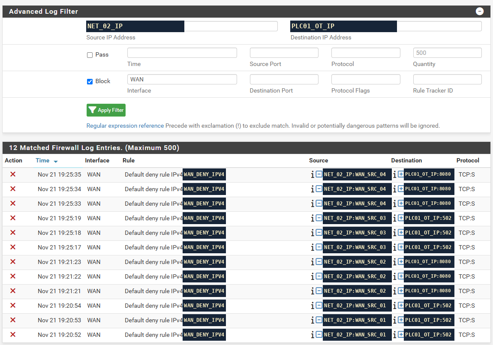

### M04-20261121-030 · f24 client eindmeting

**Deel 2, beeld 17 · F24 · TEST.** De beheer-VM toont de definitieve herhaling vanaf NET_02_IP. Beide probes naar PLC01 geven een timeout. De client toont 19:45:48 voor TCP/502 en 19:46:03 voor TCP/8080. De WAN-capture en firewallregels koppelen de pogingen via hun bronpoorten.

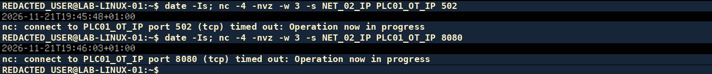

### M04-20261121-031 · f24 wan capture eindmeting actief

**Deel 2, beeld 18 · F24 · TEST.** De pfSense-shell toont het gebruikte tcpdump-filter op WAN em1 en zes overeenkomende SYN-pakketten. Voor TCP/502 is de bronpoort WAN_SRC_05. Voor TCP/8080 is de bronpoort WAN_SRC_06. Beide pogingen zijn op WAN binnengekomen.

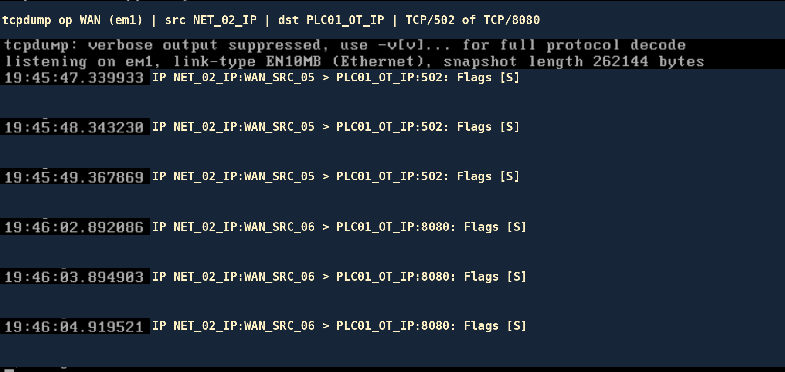

### M04-20261121-032 · f24 ot capture na probes actief

**Deel 2, beeld 19 · F24 · TEST.** Om 19:47 toont de webinterface nog Running packet capture voor het OT-bestand F24-OT-EINDMETING.pcap. Het filter dekt beide endpoints en poorten en het uitvoerveld is leeg. De capture-alias en de zichtbare systeemklok onderbouwen de dekking van de eindmeting.

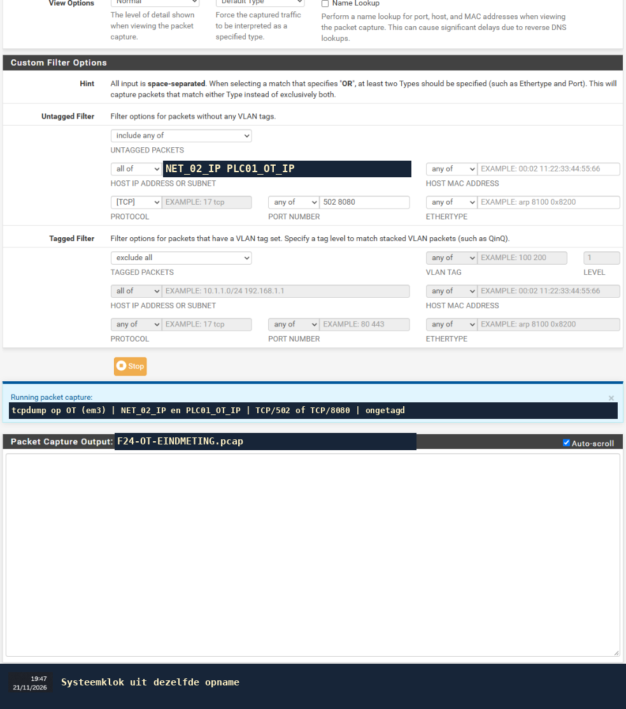

### M04-20261121-033 · f24 ot capture eindmeting gestopt

**Deel 2, beeld 20 · F24 · TEST.** De gestopte OT-capture toont dezelfde bestandsnaam en een leeg uitvoerveld. De GUI herhaalt 19:44:26 als start-en stoptijd. Gebruik het afzonderlijke beeld van de nog actieve capture om 19:47 en het bijgevoegde PCAP-bestand voor de bewijsbinding.

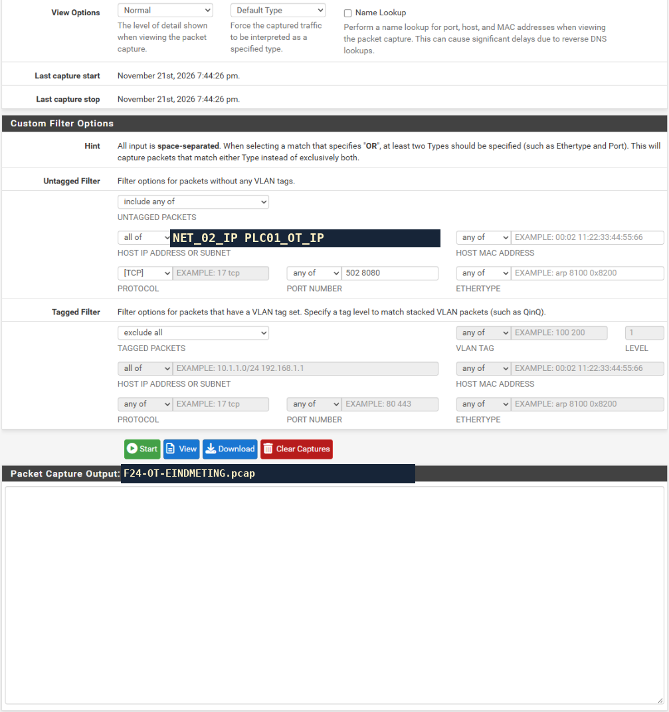

### M04-20261121-034 · f24 wan capture eindmeting zes syn

**Deel 2, beeld 21 · F24 · TEST.** De eindteller op em1 is zes captured packets en nul kernel-drops. TCP/502 toont SYN-pakketten van bronpoort WAN_SRC_05 om 19:45:47.339933 tot 19:45:49.367869. TCP/8080 toont bronpoort WAN_SRC_06 om 19:46:02.892086 tot 19:46:04.919521.

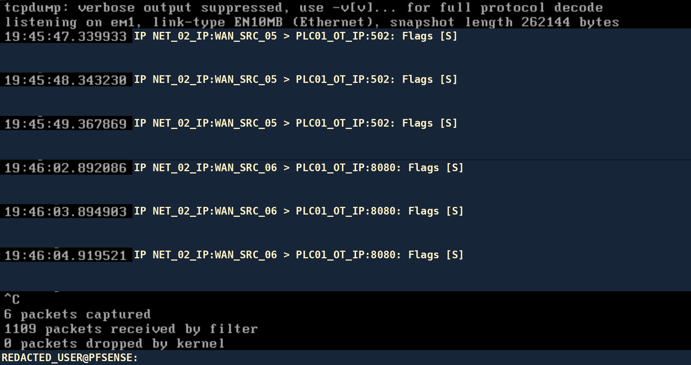

### M04-20261121-035 · f24 bloklog eindmeting tcp 502

**Deel 2, beeld 22 · F24 · LOG.** Filter WAN, Block en bronpoort WAN_SRC_05. pfSense logt drie geblokkeerde TCP SYN-pakketten naar PLC01:502 om 19:45:47–19:45:49. De regel is Default deny rule IPv4, trackeralias WAN_DENY_IPV4.

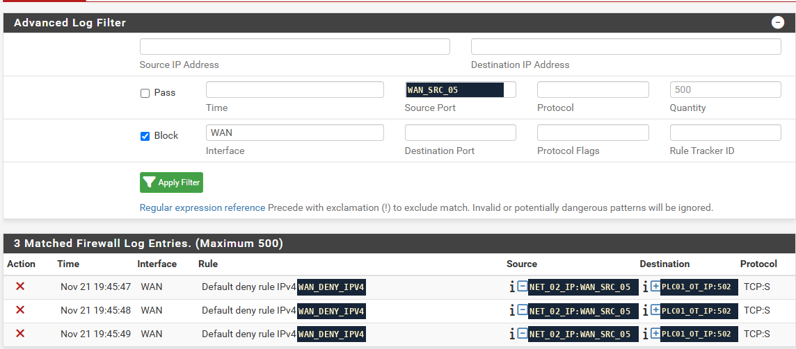

### M04-20261121-036 · f24 bloklog eindmeting tcp 8080

**Deel 2, beeld 23 · F24 · LOG.** Filter WAN, Block en bronpoort WAN_SRC_06. pfSense logt drie geblokkeerde TCP SYN-pakketten naar PLC01:8080 om 19:46:03–19:46:05, onder dezelfde IPv4-default-deny (trackeralias WAN_DENY_IPV4). De fracties van seconden in de capture en de logweergave op hele seconden verklaren het zichtbare verschil in tijdnotatie.

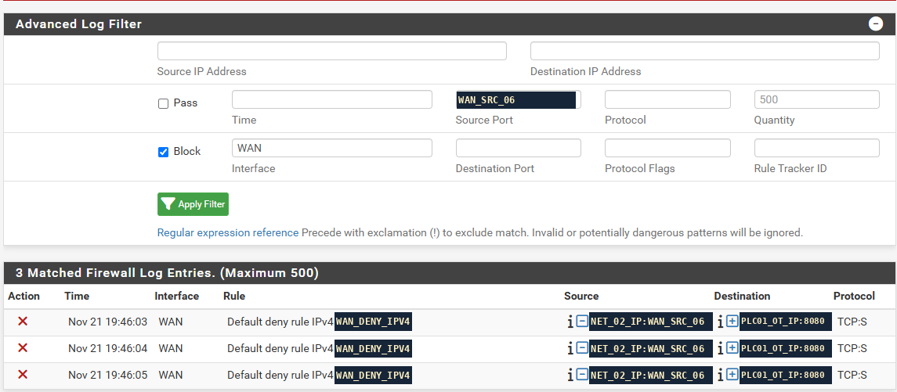

### M04-20261121-037 · f24 rollback wan hostroute

**Deel 2, beeld 24 · F24 · TEST.** De beheer-VM verwijdert de tijdelijke /32-route naar PLC01_OT_IP via pfSense WAN op ens37. De daaropvolgende exacte routequery geeft lege uitvoer. Het beeld legt de verwijdering van de F24-route vast.

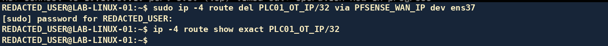

### M04-20261121-038 · f24 cockpit beheerpad hersteld

**Deel 2, beeld 25 · F24 · TEST.** Cockpit toont de actieve beheersessie op MGMT_NET_IP:9090 na de test. Het Host-only-beheerpad is weer bereikbaar. Dit scherm toont geen actuele VMware-verbindingsstatus van de NAT-en LAN Segment-adapters.

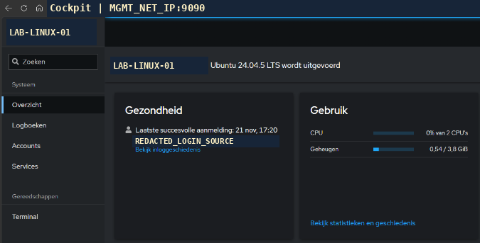
