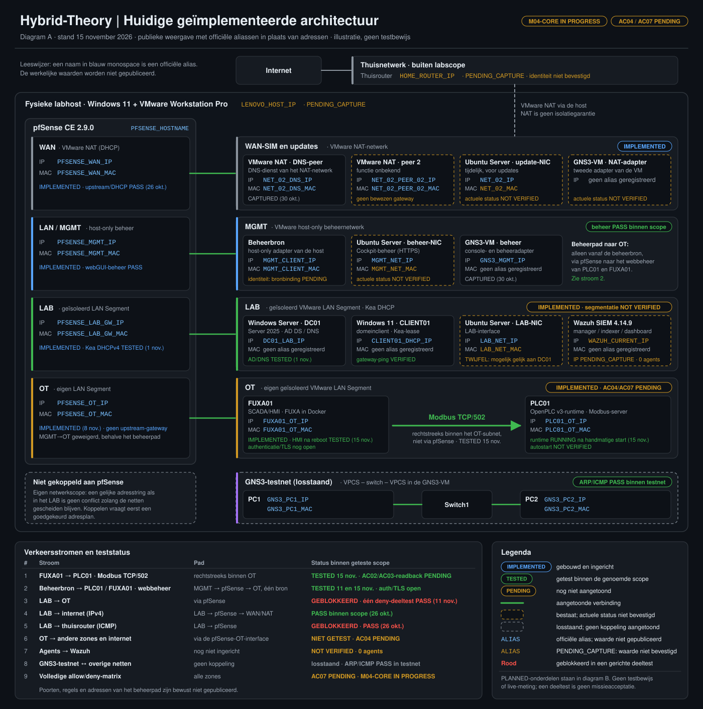

# Hybrid-Theory

## Cybersecurity engineering voor hybride IT/OT-omgevingen

Hybrid-Theory is een hands-on cybersecurity-engineeringlab en experimenteel onderzoeksproject. Het onderzoekt hoe architectuur, netwerkgrenzen, identiteit en onderlinge afhankelijkheden invloed hebben op beveiliging en systeemrisico. De nadruk ligt op aantoonbare, afgebakende tests en transparante documentatie; het project claimt geen certificering of volledige missieacceptatie.

### In 60 seconden

- **Domein:** hybride IT/OT-beveiliging, netwerksegmentatie, virtualisatie, identity & access management en security engineering.
- **Huidige basis:** VMware Workstation met pfSense en afzonderlijke WAN-SIM-, MGMT-, LAB- en OT-netwerken; Windows Server/AD DS, Windows 11, Ubuntu, GNS3/Wireshark, OpenPLC, FUXA en Wazuh.
- **Ontwerp:** PLC en HMI zijn ingericht op het OT-netwerk. Het doelontwerp met aanvullende zones, Azure en onafhankelijke recovery is ontwerp/planning, geen gerealiseerde omgeving.
- **Werkwijze:** baseline, gescopeerde test, resultaat en bewijsgrens worden apart vastgelegd. Een configuratie of screenshot is niet op zichzelf bewijs van werking of missievoltooiing.
- **Resultaten:** AD/DNS, domain join en één GPO zijn binnen scope getest; GNS3 ARP/ICMP-tests zijn gedocumenteerd. Wazuh-dashboardtoegang is getest, maar agentdetectie is niet aangetoond.

### Architectuur

[Huidige architectuur · Diagram A](architectuur/diagrammen/HT-ARCHITECTUUR-A-HUIDIG-PUBLIC-2026-11-15.svg) · [Doelarchitectuur · Diagram B](architectuur/diagrammen/HT-ARCHITECTUUR-B-DOELONTWERP-PUBLIC-2026-11-15.svg) · [Architectuur- en netwerkontwerp](architectuur/README.md)

Diagram A toont de huidige netwerken en geïmplementeerde onderdelen; Diagram B is een doelontwerp. Beide zijn architectuurillustraties, geen zelfstandig testbewijs. Zie ook de [architectuurbaseline](architectuur/ARCHITECTUUR_BASELINE.md) en het [netwerkontwerp](architectuur/NETWERKONTWERP.md).

### Missies en aantoonbare voortgang

**Actuele missie-issues | M05 bovenaan bij GitHub Created on → Newest:** [M01 · Hypervisor Fortress](https://github.com/SamAsgar/Hybrid-Theory-Public/issues/42) → [M02 · Phoenix Recovery](https://github.com/SamAsgar/Hybrid-Theory-Public/issues/43) → [M03 · Identity Dominion](https://github.com/SamAsgar/Hybrid-Theory-Public/issues/44) → [M04 · Network Citadel](https://github.com/SamAsgar/Hybrid-Theory-Public/issues/45) → [M05 · Compliance Sentinel](https://github.com/SamAsgar/Hybrid-Theory-Public/issues/46). De oorspronkelijke logboeken en eerdere index-issues blijven als gesloten archief beschikbaar.

| Missie | Status en beknopte scope |
|---|---|
| **M01 — Hypervisor Fortress** | **IN PROGRESS**; gerichte HV-01–HV-04-deelcontroles met **PASS** en één **EXCEPTION**. Geen volledige M01-PASS. [Missiedocumentatie](bewijsvoering/M01-Hypervisor-Fortress/README.md) |
| **M02 — Phoenix Recovery** | **PENDING**; herstelarchitectuur is beschreven, maar onafhankelijke off-host restore is niet aangetoond. [Ontwerp en status](governance/M02-Phoenix-Recovery/README.md) |
| **M03 — Identity Dominion** | **IN PROGRESS**; AD/DNS, domain join, testlogin en één GPO zijn **PASS binnen scope**; Entra is **PLANNED**. [AD-baselinerapport](projectlogboeken/2026-11-01-ad-dns-domainjoin-gpo-samenvatting.md) |
| **M04 — Network Citadel** | **M04-CORE IN PROGRESS**; post-migratie PLC/HMI-start/stop **0→1→0 functioneel TESTED / scoped PASS**. Gerichte LAB/OT/egress-deny-tests zijn met firewalllogs gecorreleerd; geautoriseerde beheerpoorten zijn positief getest (**scoped PASS**). Integrale AC04/AC07-matrix, onafhankelijke evidence-review en eigenaaracceptatie blijven **PENDING**. Geen volledige M04-PASS. [Missiedocumentatie](bewijsvoering/M04-Network-Citadel/README.md) |
| **M05 — Compliance Sentinel** | **PENDING**; geen afgeronde assurance-acceptatie. [Regelgevings- en assurancekaders](governance/WET_EN_REGELGEVING.md) |

### Bewijsvoering

| Missie | Gepubliceerde bewijsset | Detail |
|---|---|---|
| **M01** | 82 gesaneerde screenshots | [Bewijsindex](bewijsvoering/M01-Hypervisor-Fortress/EVIDENCE-INDEX.md) · [Saneringsrapport](bewijsvoering/M01-Hypervisor-Fortress/M01-SANITIZATION-REPORT.md) |
| **M04** | 265 gesaneerde screenshots in 20 fasen | [Bewijsindex](bewijsvoering/M04-Network-Citadel/M04-EVIDENCE-INDEX.md) · [Galerij per fase](bewijsvoering/M04-Network-Citadel/M04-GALERIJ.md) · [Nieuwe fase 20](bewijsvoering/M04-Network-Citadel/20_OT_segmentation_and_regression/README.md) · [Saneringsrapport](bewijsvoering/M04-Network-Citadel/M04-SANITIZATION-REPORT.md) |

De beelden ondersteunen alleen de afzonderlijk beschreven observaties en tests; ze bewijzen geen volledige missieafronding. Aanvullende [componentbewijsvoering](bewijsvoering/VMware/) en de [bewijsvoering per missie](bewijsvoering/README.md) zijn beschikbaar.

### Status lezen

De termen volgen de [statuslegenda](governance/STATUSLEGENDA.md):

- **IMPLEMENTED:** component of instelling is ingericht; werking volgt daar niet automatisch uit.
- **TESTED:** een specifieke test is uitgevoerd binnen de gedocumenteerde scope; dit zegt op zichzelf niet dat de criteria zijn gehaald.
- **VERIFIED:** een specifieke componentfunctie is met bewijs en binnen een vastgelegde scope gecontroleerd.
- **PASS:** acceptatiecriteria zijn gehaald binnen de expliciete testscope.
- **EXCEPTION:** bewust geaccepteerd restrisico; geen automatische PASS.
- **PENDING:** uitvoering, besluit of meting staat nog open.

### Technische aanpak en documentatie

Het portfolio legt ontwerpkeuzes, trust boundaries, testmethodologie, resultaten en openstaande verificaties vast. De bredere onderzoeksvraag verkent systeemrisico en cross-layer dependencies; CAT/ACE is een experimenteel concept en **niet gevalideerd**.

[Roadmap](projectlogboeken/ROADMAP.md) · [Projectlogboeken](projectlogboeken/README.md) · [Governance](governance/README.md) · [CAT/ACE-onderzoeksdocumentatie](governance/CAT_ACE_v0.4.md) · [Academische achtergrond](onderzoek/academische-referenties/README.md) · [AI-samenwerking](ai-samenwerking/README.md)

**Publicatiegrens:** de repository bevat gesaneerde architectuurillustraties en bewijsafgeleiden; private bronbestanden zijn niet opgenomen. Gepubliceerde bestanden en afzonderlijke tests zijn geen algemene security- of acceptatie-PASS.
