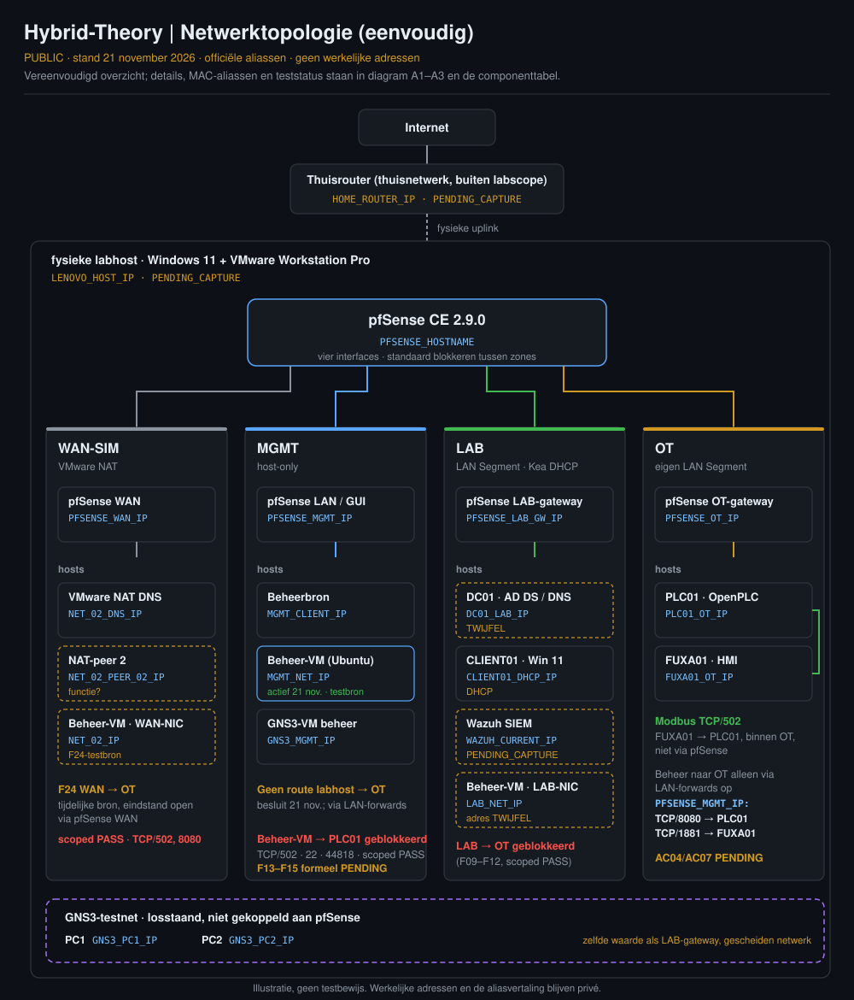

# Hybrid-Theory

**Een zelfstandig gebouwd cybersecuritylab voor bedrijfs-IT en industriële besturing (OT).** In dit project onderzoek ik een praktische vraag. Hoe houd je een installatie bedienbaar en beperk je tegelijk welke systemen de besturing kunnen bereiken?

Op één fysieke host heb ik met VMware een bedrijfsnetwerk, een beheeromgeving en een gesimuleerde industriële installatie ingericht. Met Active Directory test ik hoe gebruikers toegang krijgen. Met de pfSense-firewall test ik welk verkeer tussen de netwerken is toegestaan. Per proef leg ik vast wat ik verwacht, wat ik waarneem en welke vragen openblijven.

## Het lab in beeld

[Gedetailleerde topologie met netwerkzones](Architectuur/diagrammen/HT-ARCHITECTUUR-A1-TOPOLOGIE-PUBLIC-2026-11-21.svg) · [Architectuur en ontwerpkeuzes](Architectuur/README.md)

## Praktijkvoorbeeld · Network Citadel

Een bedieningsscherm (FUXA) stuurt een industriële controller (OpenPLC) aan die een motor simuleert. Nadat ik beide systemen naar het OT-netwerk had verplaatst, testte ik twee dingen die voor een bedrijf tegelijk moeten kloppen:

- **Kan de operator de installatie blijven bedienen?** Na een herstart gaf ik via het scherm een start- en stopcommando. In de controller las ik de bijbehorende statusverandering terug. [Bedieningstest van 19 november](Projectlogboeken/2026-11-19-m04-openplc-autostart-en-ot-regressie.md)
- **Houdt de firewall ongewenste toegang tegen?** pfSense blokkeerde vanaf de beheer-VM drie directe pogingen naar de controller. Vanaf een gesimuleerde WAN-bron bereikten zes SYN-pakketten de firewall op TCP/502 en TCP/8080. Alle zes werden geblokkeerd. De gelijktijdige gefilterde OT-capture bleef leeg. [LAN- en WAN-tests van 21 november](Projectlogboeken/2026-11-21-m04-core-management-segmentatie.md)

## Identiteit en bedrijfscontinuïteit

**Hoe weet je of centraal beleid een werkplek bereikt?** Ik koppelde een Windows 11-werkplek aan een domein op Windows Server 2025 en meldde me aan met een testaccount. Een centraal ingestelde regel beperkte voor die gebruiker de toegang tot het Configuratiescherm. Zo kon ik op de werkplek zelf controleren of het beleid effect had. [Lees de identiteitsproef](Projectlogboeken/2026-11-01-ad-dns-domainjoin-gpo-samenvatting.md)

**Wat gebeurt er als de fysieke host uitvalt?** De virtuele systemen delen één machine. Daardoor kan één storing meerdere diensten tegelijk raken. Voor dat scenario heb ik een herstelontwerp uitgewerkt met een aparte lokale herstelserver en een back-up buiten de locatie. De volgende stap is een systeem daadwerkelijk terugzetten en meten hoe lang het duurt voordat de dienst weer bruikbaar is. [Bekijk het herstelontwerp](Governance/M02-Phoenix-Recovery/README.md)

## Missies

De vijf missies bestrijken de onderliggende systemen, herstel na uitval, identiteit, netwerkbeveiliging en de beoordeling van maatregelen. De stand hieronder is van 21 november 2026. Voor alle vijf staat de eerste milestone nog open.

| Missie | Voortgang |
|---|---|
| [M01 · Hypervisor Fortress](https://github.com/SamAsgar/Hybrid-Theory-Public/issues/42) | Een deel van de controles op host en hypervisor is uitgevoerd. Voor klembord en slepen tussen host en gast geldt een uitzondering op geselecteerde Windows-VM’s. |
| [M02 · Phoenix Recovery](https://github.com/SamAsgar/Hybrid-Theory-Public/issues/43) | Het herstelontwerp ligt er. Een restore op een afzonderlijke host moet nog worden aangetoond. |
| [M03 · Identity Dominion](https://github.com/SamAsgar/Hybrid-Theory-Public/issues/44) | Centraal gebruikersbeheer met Active Directory, naamomzetting (DNS), aanmelden op het domein en één groepsbeleid zijn getest. De uitbreiding met Entra ID is gepland. |
| [M04 · Network Citadel](https://github.com/SamAsgar/Hybrid-Theory-Public/issues/45) | PLC/HMI-functionaliteit en gerichte firewallblokkeringen zijn getest; F13–F15 hebben scoped PASS vanaf de beheer-VM en F24 voor WAN→OT op TCP/502 en TCP/8080. Bronacceptatie, bewijsreview en integrale AC04/AC07 blijven open. [Publieke testmatrix](Portfolio/M04-Network-Citadel/M04-AC04-AC07-TESTMATRIX.csv) |
| [M05 · Compliance Sentinel](https://github.com/SamAsgar/Hybrid-Theory-Public/issues/46) | De onderzoeksopzet is goedgekeurd. De eerste casus is IN PROGRESS: vijfdelige kennistraining afgerond; assessment en eigenaarreview open. [Educatief dossier](Portfolio/M05-Compliance-Sentinel/C04_Network_Segmentation_OT/M05-MINI-01_ISO27001_Control_Assessment/README.md). |

## Bewijs en logboeken

Het [publieke portfolio](Portfolio/README.md) koppelt tests aan gesaneerd bewijsmateriaal. De [M01-bewijsindex](Portfolio/M01-Hypervisor-Fortress/EVIDENCE-INDEX.md) bevat 82 screenshots. De [M04-galerij](Portfolio/M04-Network-Citadel/M04-GALERIJ.md) bevat 354 gepubliceerde beelden verdeeld over 22 fasen.

[Projectlogboeken](Projectlogboeken/README.md) · [Roadmap](Projectlogboeken/ROADMAP.md) · [Statuslegenda](Governance/STATUSLEGENDA.md)
