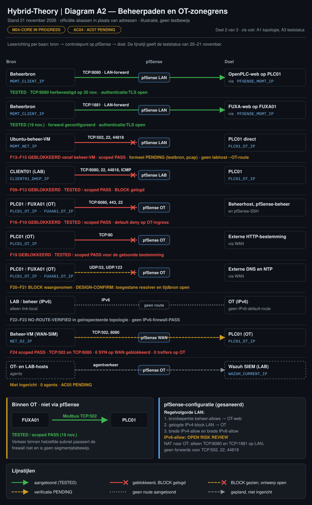
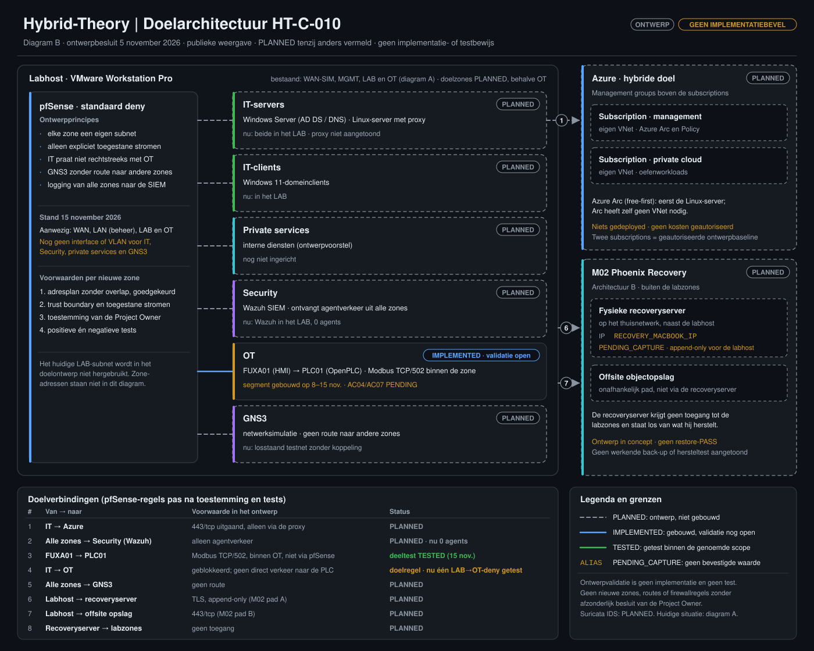

# Netwerkontwerp en beveiligingsgrenzen | Hybrid-Theory

**Bijgewerkt:** 21 november 2026 (managementtests en F24-testvoorbereiding van 21 november; diagram A gedateerd 21 november, versie van 20 november als momentopname bewaard; 19-november-regressie, CORE C2-deeltests en statusnotities van diagram B: 20 november) · **Classificatie:** gesaneerde architectuurpublicatie · **Herkomst:** private architectuur en HT-C-010.

Dit document heeft twee lagen die niet door elkaar mogen lopen: de **geobserveerde situatie** (§1) en de **doelarchitectuur HT-C-010** (§2–§3). Adressen staan als officiële alias; de [componenttabel met alle aliassen](README.md#11-componenten-zones-en-officiële-aliassen) staat in Architecture.

## 1. Geobserveerde infrastructuur (afgebakend bewijs)

| Onderdeel | Technologie | Status en bewijsgrens |
|---|---|---|
| LAB | VMware LAN Segment, pfSense/Kea DHCP (`PFSENSE_LAB_GW_IP`) | **IMPLEMENTED**; gerichte netwerk-/DHCP-/firewalltests PASS |
| OT-zone | Eigen VMware LAN Segment, aparte pfSense-interface (`PFSENSE_OT_IP`) | **IMPLEMENTED** (8 nov.), zonder upstream-gateway. PLC01 staat sinds 8–9 nov. in dit segment en FUXA01 sinds 11–15 nov. Meerdere specifieke LAB→OT- en OT→LAB-/externe-bestemming-blokkeringen zijn op 19 nov. getest en met pfSense-logs gecorreleerd; het afgebakende beheerpad is positief getest. Integrale isolatie van de zone (AC04/AC07) **NIET BEWEZEN**. [Log 8 nov.](../projectlogboeken/2026-11-08-m04-ot-firewallinterface.md) · [Log 9 nov.](../projectlogboeken/2026-11-09-m04-plc-migratie-governance-publiek.md) · [Log 11 nov.](../projectlogboeken/2026-11-11-m04-segmentatie-en-beheer-validatie.md) |
| Beheer (MGMT) | VMware host-only, Cockpit/pfSense GUI (`PFSENSE_MGMT_IP`) | Beheer binnen eerdere tests bereikbaar; actuele NIC-/routingstatus deels OPEN |
| Updates en WAN-simulatie (WAN-SIM) | VMware NAT (`PFSENSE_WAN_IP`) | Tijdelijk egresspad gebruikt; NAT is geen isolatiegarantie voor het thuisnetwerk |
| Windows/Identity | Windows Server en Windows 11 | AD DS/forest, DNS/SRV, domain join, testlogin en GPO **PASS binnen scope** |
| GNS3 | VPCS, switch, Wireshark | ARP/ICMP/capture **PASS** in een losstaande simulatie |
| FUXA01 en PLC01 | Ubuntu/Docker met FUXA (SCADA/HMI) en OpenPLC-runtime, beide in de OT-zone (`FUXA01_OT_IP`, `PLC01_OT_IP`) | Na correctie is OpenPLC bij een tweede PLC01-reboot automatisch opgestart; FUXA herverbond en START→STOP met PLC-readback is op 19 nov. **TESTED / scoped PASS**. Onafhankelijke evidence-review en formele AC01–AC03-acceptatie **PENDING**. *Historisch:* baseline AC01–AC03 **PASS binnen scope** op de eerdere NAT-topologie (6 nov.). [Log 15 nov.](../projectlogboeken/2026-11-15-m04-ot-modbus-applicatievalidatie.md) |
| Wazuh | SIEM-manager/indexer/dashboard in het LAB (`WAZUH_CURRENT_IP`, PENDING_CAPTURE) | Start en dashboardlogin **PASS**; 0 agents; agentingestie en detectie **NOT VERIFIED** |
| Recovery | M02 Phoenix Recovery | **PLANNED**; onafhankelijke restore niet aangetoond |
| Azure | Arc/Entra/VNets | **PLANNED**; niet gedeployed |

Deze gegevens komen uit gedateerde sessielogs en zijn **geen nieuwe live-meting**. pfSense heeft vier interfaces: WAN, LAN/MGMT, LAB en OT. Werkelijke adressen en de aliasvertaling worden niet gepubliceerd.

### 1.1 Huidige verkeersstromen (stand 21 november 2026)

*Figuur A2. Architectuurillustratie, **geen testbewijs**. Topologie: [diagram A1](diagrammen/HT-ARCHITECTUUR-A1-TOPOLOGIE-PUBLIC-2026-11-21.svg) · statustabel en legenda: [diagram A3](diagrammen/HT-ARCHITECTUUR-A3-TESTSTATUS-PUBLIC-2026-11-21.svg).*

| # | Stroom | Pad | Status binnen de geteste scope |
|---|---|---|---|
| 1 | FUXA01 (`FUXA01_OT_IP`) → PLC01 (`PLC01_OT_IP`), Modbus TCP/502 | **Rechtstreeks binnen het OT-subnet**; niet via de pfSense-router | TCP-handshake (15 nov.) en na PLC01-reboot FUXA-herverbinding en HMI START→STOP met PLC-readback (19 nov.) **TESTED / scoped PASS**; formele evidence-review **PENDING** |
| 2 | Beheerbron (`MGMT_CLIENT_IP`) → webbeheer van PLC01 (TCP/8080) en FUXA01 (TCP/1881) | MGMT → `PFSENSE_MGMT_IP` → bronbeperkte LAN-forward → OT; alleen vanaf de aangewezen beheerbron | **TESTED** (11 en 15 nov.; TCP/8080 herbevestigd 20 nov.); authenticatie/TLS open |
| 2a | Ubuntu-beheer-VM (`MGMT_NET_IP`) → PLC01 direct, TCP/502, 22 en 44818 (F13–F15) | Beheer-VM → pfSense LAN → beheer-naar-OT-regel; de fysieke labhost krijgt geen directe OT-route | Geblokkeerd: **TESTED / scoped PASS** vanaf de beheer-VM (21 nov.); formeel **PENDING** (afwijkende testbron, log-/pcapcorrelatie) |
| 3 | LAB → OT | Via pfSense | **Geblokkeerd binnen geteste scope**: gerichte TCP/502- en TCP/1881-denyflows (19 nov.) en LAB→PLC01 TCP/8080, 22, 44818 en ICMP (F09–F12, 20 nov.) met pfSense-BLOCK-logs, **TESTED / scoped PASS**; niet de gehele AC04/AC07-matrix |
| 4 | LAB → publiek IPv4 | LAB → pfSense → WAN (VMware NAT) | **PASS** binnen scope (26 okt.) |
| 5 | LAB → thuisrouter (ICMP) | LAB → pfSense | **Geblokkeerd**: **PASS** (26 okt.), alleen voor de geteste bestemming en dit protocol |
| 6 | OT → andere zones en internet | Via de pfSense-OT-interface | Gerichte OT→LAB ICMP en OT→extern ICMP/TCP 443 (19 nov.) en OT→beheerhost, pfSense-beheer, pfSense-SSH en externe HTTP (F16–F19, 20 nov.) zijn met pfSense-BLOCK-events gecorreleerd (**TESTED / scoped PASS**); alternatieve paden/protocollen en integrale AC04 **PENDING** |
| 6a | OT → externe DNS (UDP/53) en NTP (UDP/123) (F20/F21) | Via de pfSense-OT-interface | Geblokkeerd waargenomen; goedgekeurde resolver en tijdbron **DESIGN-CONFIRM** |
| 6b | IPv6 LAB/beheer → OT (F22/F23) | Alleen link-local op de onderzochte LAB-/OT-hosts, geen IPv6-default-route | **NO-ROUTE-VERIFIED** binnen de geïnspecteerde topologie; geen IPv6-firewall-PASS; brede LAN IPv6-allow onder review |
| 6c | WAN → OT (F24) | WAN-SIM → pfSense WAN; als tijdelijke testbron is na de managementtests de WAN-SIM-adapter van de beheer-VM (`NET_02_IP`) actief gemaakt, die pfSense WAN bereikt | Geen gebruikers-PASS en geen WAN-forwards in de bekeken configuratie: **CONFIG REVIEWED / SAFE LIVE TEST PENDING**; geen PASS zonder gelogde blokkade en bewijs |
| 7 | Agents en OT-telemetrie → Wazuh | Nog niet ingericht | **NOT VERIFIED**; 0 agents; AC05 **PENDING** |
| 8 | GNS3-testnet ↔ overige netten | Geen koppeling | Losstaand; ARP/ICMP **PASS** binnen het testnet |

Stroom 1 is **geen firewallregel**: verkeer tussen twee hosts in hetzelfde subnet passeert de firewall niet en zegt dus niets over de zonegrens. Het beheerpad gebruikt de aangewezen bron en de expliciet toegestane webservices. Zie de C2-update voor de actuele scope. **M04-CORE blijft IN PROGRESS.**

## 2. HT-C-010: doelarchitectuur en toekomstige netwerkgrenzen

*Figuur B. Ontwerpillustratie, **geen configuratiebewijs**. De bestaande netwerken WAN-SIM, MGMT, LAB en OT zijn **IMPLEMENTED** (figuur A). Van de zes HT-C-010-doelzones bestaat alleen OT al als eigen segment; IT-servers, IT-clients, Security, private services en GNS3 zijn als afzonderlijke zones **PLANNED**, net als Azure en M02.*

De doelarchitectuur scheidt IT-servers, clients, private services, Security/Wazuh, OT/FUXA/OpenPLC en GNS3. pfSense **default deny** met expliciet goedgekeurde diensten is de ontwerpregel, maar zulke zoneinterfaces en VLAN's zijn **niet automatisch gerealiseerd**: alleen de OT-interface bestaat.

| Van | Naar | Doeleis / status |
|---|---|---|
| IT | OT/PLC | Directe toegang blokkeren; gerichte LAB→OT-denies (19 nov.) getest, **nog niet als volledige zonegrens bewezen** |
| GNS3 | Andere zones | Geen route; afzonderlijk GNS3-bewijs bewijst dit niet zelfstandig |
| IT- en OT-agents | Wazuh | Alleen toegestaan agentverkeer; end-to-end ingestie nog te testen |
| FUXA01 | PLC01 | Strikt begrensde Modbus-communicatie (TCP/502) binnen de OT-zone; verkeer binnen hetzelfde segment loopt niet via de firewall. Deeltest **TESTED** (15 nov.) |
| IT-services | Azure | Alleen compatibele en toegestane uitgaande HTTPS-/proxyverbindingen |
| Labhost | Recovery-host/offsite | Onafhankelijke M02-back-uproutes volgens goedgekeurd herstelontwerp |

## 3. Recovery en Azure

De M02-doelarchitectuur houdt een toekomstige recoveryhost **buiten de virtuele labzones** en voorziet in een zelfstandig offsite-back-uppad. Geen restore-PASS of werkende immutable retentie wordt geclaimd.

De HT-C-010-baseline gebruikt **twee** voorgestelde subscriptions, elk met een eigen VNet: één voor management en één voor private-cloudoefeningen. Azure Arc vereist **op zichzelf geen VNet**. Geen cloudresource of kosten zijn op basis van deze afbeelding geautoriseerd of geïmplementeerd.

## 4. Openstaande punten en publicatiebeperkingen

- **TWIJFEL:** `LAB_NET_IP` (Ubuntu) en `DC01_LAB_IP` (Windows Server) zijn op verschillende meetdatums met dezelfde waarde vastgelegd; gelijktijdig conflict niet aangetoond. De waarde blijft privé.
- **TWIJFEL:** `GNS3_PC1_IP` in de zelfstandige GNS3-test heeft dezelfde waarde als `PFSENSE_LAB_GW_IP`. De netwerken zijn gescheiden; een daadwerkelijke botsing is daarmee niet bewezen en ontstaat pas bij koppeling.
- **OPEN:** actuele lease-/interfacegegevens (o.a. `WAZUH_CURRENT_IP`), Wazuh-agentingestie, formele AC01–AC03-evidence-review, hersteltest en integrale OT-segmentatietests (AC04/AC07), hersteltests en Azure-toegang.
- **DOEL / GEEN AUTO-MIGRATIE:** nieuwe zones, routes, firewallregels of cloudresources vereisen expliciete scope, autorisatie, kostencontrole en relevante positieve/negatieve tests.

**Publicatie:** geen fysieke hostnamen, privérouteradressen, concrete IP-/MAC-adressen of private aliasvertalingen; alleen de officiële aliasnamen. Deze gesaneerde illustraties zijn geen audit- of compliancebewijs. Zie [Architecture](README.md) en [publicatiebeleid](../governance/PUBLICATIEBELEID.md).
## 5. M04-harmonisatie 19–20 november 2026

De op 19 november gedocumenteerde reboottest van PLC01 begon met **FAIL** (runtime aanwezig, motorprogramma gestopt). Na correctie van RUN-autostart volgden een geslaagde tweede reboot, FUXA-herverbinding en HMI START→STOP met PLC-statusreadback (**TESTED / scoped PASS**). Dit verandert de historische 15-november-baseline niet met terugwerkende kracht.

De nieuwe [M04-fase-20-galerij](../Portfolio/M04-Network-Citadel/M04-Bewijsvoering/20_OT_segmentation_and_regression/README.md) koppelt de deeltests aan gesaneerde screenshots. Specifieke LAB→OT, OT→LAB en OT→extern-negatieve flows zijn met BLOCK-logs verbonden. **Geen volledige AC04/AC07-acceptatie**: de resterende matrix vergt onder meer IPv6, UDP, beheer/NAT-scope, WAN→OT, alternatieve routes en tijd-/regel-/pcapcorrelatie.

De private M04-testaanpak is op 20 november gerichter gemaakt om dubbele tests te vermijden, niet om controls over te slaan. pfSense-regelwijzigingen blijven onder autorisatie en herstelgates vallen; de getoonde back-upopties zijn **geen bewijs van een geslaagde config.xml-restore**. Diagram A (stand 20 november) en diagram B (ontwerp 5 november, statusnotities 20 november) zijn illustraties; er zijn geen nieuwe aparte zones of Azure-resources geïmplementeerd. De versies van 15 november blijven als historische weergave bewaard.

## M04 AS-IS | Netwerkpaden beoordeeld op 20 november

LAB en OT blijven afzonderlijke VMware LAN Segments. De aangewezen beheerbron `MGMT_CLIENT_IP` bereikt via het host-only segment het firewallbeheer op `PFSENSE_MGMT_IP`. De firewall beperkt de beheertoegang tot de webservices OpenPLC TCP/8080 en FUXA TCP/1881 vanaf de aangewezen bron. TCP/8080 via de beheerforward is in deze sessie opnieuw aangetoond. De directe route van de beheerhost naar de PLC koos de fysieke uplink. Het directe beheerpad en de drie negatieve PLC-proeven blijven open.

De C2-sessie bevestigde gerichte LAB→PLC- en OT→beheer/firewall/extern-blokkades. Het IPv6-resultaat beschrijft de routes en L2-scope van de bekeken opstelling. Een brede LAN IPv6-allow blijft onder review. Voor de WAN-zijde is de configuratie bekeken en staat de veilige live proef open. Wazuh OT-telemetrie, GNS3-schaaluitwerking en Suricata-alertcorrelatie horen bij EXT.

[C2-projectlog](../projectlogboeken/2026-11-20-m04-core-c2-netwerkvalidatie.md) · [pfSense-controles](PFSENSE_PLAN.md#m04--configuratiereview-en-deeltests-op-20-november).

## Actualisatie 21 november 2026 — beheerzone/OT-ontwerp

In de bestaande topologie is vanuit een afzonderlijke virtuele managementbron driemaal een directe verbinding naar de PLC geprobeerd: Modbus TCP/502, SSH TCP/22 en EtherNet/IP TCP/44818. Volgens de eigenaarsessie blokkeerde pfSense deze drie verbindingen op de beheer-naar-OT-grens. **TESTED / scoped PASS voor de geteste managementbron.** De canonieke F13–F15-matrix noemt een andere bron; expliciete bronacceptatie, packetcapture-/log-review en rollbackbewijs zijn nog **PENDING**. Integrale AC04/AC07: **PENDING**.

De fysieke VMware-host krijgt geen permanente directe OT-route. Het beperkte webbeheer via de bestaande firewallportforwards blijft tijdelijk gehandhaafd. Uitbreiding van het virtuele beheerwerkstation en de industriële DMZ is uitgesteld tot na M04-CORE. De in het eerdere document opgenomen stand van 20 november blijft historische context.

**F24-testvoorbereiding (21 november, na de managementtests):** de WAN-SIM-adapter van de beheer-VM stond tijdens de managementtests los en is daarna als **tijdelijke testbron** actief gemaakt; hij bereikt pfSense WAN rechtstreeks. Dat is geen ontwerpkeuze en geen WAN→OT- of beheerverbinding. F24 blijft **CONFIG REVIEWED / SAFE LIVE TEST PENDING**.

[Gesaneerd testlog 21 november](../projectlogboeken/2026-11-21-m04-core-management-segmentatie.md) · [M04 Issue #45](https://github.com/SamAsgar/Hybrid-Theory-Public/issues/45).
