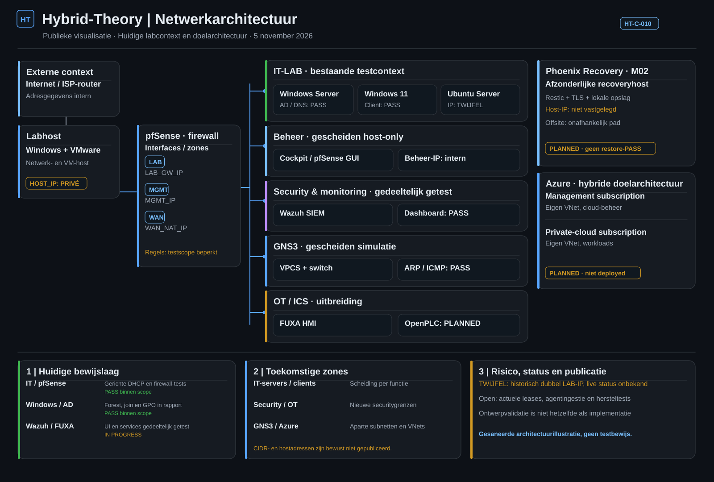

# Netwerkontwerp en beveiligingsgrenzen | Hybrid-Theory

**Bijgewerkt:** 9 november 2026 (§1: OT-zone en FUXA/OpenPLC; §4: openstaande punten) · **Classificatie:** gesaneerde architectuurpublicatie · **Herkomst:** HT-C-010 in de private bron.

## 1. Geobserveerde infrastructuur (afgebakend bewijs)

| Onderdeel | Technologie | Status en bewijsgrens |
|---|---|---|
| LAB | VMware LAN Segment, pfSense/Kea DHCP | **IMPLEMENTED**; gerichte netwerk-/DHCP-/firewalltests PASS |
| OT-zone (firewallzijde) | Eigen VMware LAN Segment, aparte pfSense-interface | **IMPLEMENTED** (8 nov.): eigen subnet uit het doelontwerp, zonder upstream-gateway. Volgens de Project Owner staat de virtuele PLC sinds 8–9 nov. in dit segment, met een beperkt beheerpad vanaf één aangewezen beheerbron (**gemeld**, bewijs niet onafhankelijk geverifieerd); de HMI staat er nog niet. Isolatie van de zone **NIET BEWEZEN**. [Log 8 nov.](../projectlogboeken/2026-11-08-m04-ot-firewallinterface.md) · [Log 9 nov.](../projectlogboeken/2026-11-09-m04-plc-migratie-governance-publiek.md) |
| Beheer | VMware host-only, Cockpit/pfSense GUI | Beheer binnen eerdere tests bereikbaar; actuele NIC-/routingstatus deels OPEN |
| Updates en WAN-simulatie | VMware NAT | Tijdelijk egresspad gebruikt; NAT is geen isolatiegarantie voor het thuisnetwerk |
| Windows/Identity | Windows Server en Windows 11 | AD DS/forest, DNS/SRV, domain join, testlogin en GPO **PASS binnen scope** |
| GNS3 | VPCS, switch, Wireshark | ARP/ICMP/capture **PASS** in een losstaande simulatie |
| FUXA en OpenPLC | Ubuntu/Docker/HMI en PLC-runtime; de HMI tijdelijk op VMware NAT, de PLC volgens de Project Owner sinds 8–9 nov. in de OT-zone (**gemeld**) | Functionele baseline AC01–AC03 **PASS binnen scope** (6 nov., vóór de migratie; regressie **PENDING**); de HMI is **niet** in de OT-zone; OT-isolatie **NIET BEWEZEN** |
| Wazuh | SIEM-manager/indexer/dashboard | Start en dashboardlogin **PASS**; agentingestie en detectie **OPEN** |
| Recovery | M02 Phoenix Recovery | **PLANNED**; onafhankelijke restore niet aangetoond |
| Azure | Arc/Entra/VNets | **PLANNED**; niet gedeployed |

Deze gegevens komen uit historische sessielogs en zijn **geen nieuwe live-meting**. Echte adres-/hostmappings worden niet in de publieke bron gepubliceerd.

## 2. HT-C-010: toekomstige netwerkgrenzen

De doelarchitectuur scheidt IT-servers, clients, private services, Security/Wazuh, OT/FUXA/OpenPLC en GNS3. pfSense **default deny** met expliciet goedgekeurde diensten is de ontwerpregel, maar zulke zoneinterfaces en VLAN's zijn **niet automatisch gerealiseerd**.

| Van | Naar | Doeleis / status |
|---|---|---|
| IT | OT/PLC | Directe toegang blokkeren; **nog niet als volledige zonegrens bewezen** |
| GNS3 | Andere zones | Geen route; afzonderlijk GNS3-bewijs bewijst dit niet zelfstandig |
| IT- en OT-agents | Wazuh | Alleen toegestaan agentverkeer; end-to-end ingestie nog te testen |
| FUXA | OpenPLC | Strikt begrensde Modbus-communicatie binnen de OT-zone; verkeer binnen hetzelfde segment loopt niet via de firewall |
| IT-services | Azure | Alleen compatibele en toegestane uitgaande HTTPS-/proxyverbindingen |
| Labhost | Recovery-host/offsite | Onafhankelijke M02-back-uproutes volgens goedgekeurd herstelontwerp |

## 3. Recovery en Azure

De M02-doelarchitectuur houdt een toekomstige recoveryhost **buiten de virtuele labzones** en voorziet in een zelfstandig offsite-back-uppad. Geen restore-PASS of werkende immutable retentie wordt geclaimd.

De huidige cloudbaseline gebruikt twee voorgestelde subscriptions, elk met een eigen VNet: één voor management en één voor private-cloudoefeningen. Azure Arc vereist **op zichzelf geen VNet**. Geen cloudresource of kosten zijn op basis van deze afbeelding geautoriseerd of geïmplementeerd.

## 4. Openstaande punten en publicatiebeperkingen

- **TWIJFEL:** hetzelfde LAB-adres is historisch voor twee verschillende VM's gedocumenteerd; gelijktijdig conflict niet aangetoond. De waarde blijft privé.
- **TWIJFEL:** een adres in een zelfstandige GNS3-test kwam overeen met een adres in een ander LAB. Gedeelde netwerkscope of daadwerkelijke botsing is daarmee niet bewezen.
- **OPEN:** actuele lease-/interfacegegevens, Wazuh-agentingestie, migratie van de HMI naar de OT-zone, onafhankelijke verificatie van de gemelde PLC-migratie en OT-segmentatietests, hersteltests en Azure-toegang.
- **DOEL / GEEN AUTO-MIGRATIE:** nieuwe zones, routes, firewallregels of cloudresources vereisen expliciete scope, autorisatie, kostencontrole en relevante positieve/negatieve tests.

**Publicatie:** geen fysieke hostnamen, privérouteradressen, concrete IP-/MAC-adressen of private aliasvertalingen. Deze gesaneerde illustratie is geen audit- of compliancebewijs. Zie [Architecture](README.md) en [publicatiebeleid](../governance/PUBLICATIEBELEID.md).