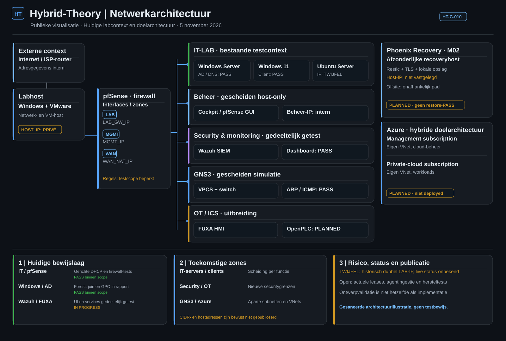

# Architectuur | Hybrid-Theory

**Bijgewerkt:** 5 november 2026 · **Bron:** private HT-C-010-doelarchitectuur · **Weergave:** gesaneerd.

## 1. Netwerktopologie — publieke visualisatie

*Figuur 1. **Gesaneerde architectuurillustratie** in GitHub Dark-stijl. Werkelijke host-, router-, beheer- en lab-IP-adressen ontbreken bewust. De getoonde relaties zijn logisch/conceptueel, geen live-netwerktopologie en geen testbewijs.*

Deze weergave is afgeleid van de bijgewerkte **private Architecture**, maar publiceert geen interne IP-mapping, de originele private afbeelding of adresgegevens. De private HT-C-010 is door de Project Owner als **doelontwerp** gevalideerd, niet technisch uitgerold. Een toekomstige zone is niet automatisch een actieve VLAN of pfSense-interface.

## 2. Huidige en geplande onderdelen

| Onderdeel | Bewezen basis | Doel / resterende validatie |
|---|---|---|
| VMware en pfSense | Host met meerdere VM's; gerichte LAB-, DHCP- en firewallproeven | Verdere segmentatie en volledige isolatietests |
| Windows Server en Windows 11 | AD DS, DNS/SRV, domain join, testlogin en GPO binnen afgebakende scope | Hardening, redundantie en herstelbaarheid |
| Ubuntu en Cockpit | Linuxbeheer en beperkte beheertoegang getest | Private services, optionele Azure Arc-agent |
| Wazuh SIEM | Manager/indexer/dashboard gestart, dashboardlogin bereikt | Agentingestie, detectie en dedicated Security-zone |
| GNS3 en Wireshark | Gescheiden VPCS-switch-test met ARP/ICMP | Uitgebreid netwerk, isolatie en routevalidatie |
| FUXA / OpenPLC | FUXA UI en editor bereikbaar | OpenPLC, Modbus-communicatie en OT-zone |
| Phoenix Recovery M02 | Architectuur B ontworpen | Onafhankelijke recoveryhost, offsite en restoretest |
| Azure / Entra / Arc | Architectuurvoorstel | Twee afzonderlijke subscriptions/VNets, kostenreview en deployment |

**Bewijsregel:** een geïnstalleerde VM of werkend dashboard is niet automatisch een voltooide securitycontrole. Losse tests gelden alleen binnen hun gedocumenteerde scope.

## 3. Netwerkgrenzen en onzekerheid

De huidige LAB-, MGMT- en NAT-context wordt uitdrukkelijk **gescheiden** van geplande IT-, Security-, OT-, GNS3- en private-serviceszones. Een historisch mogelijk dubbel LAB-adres is **TWIJFEL / NOG TE VERIFIËREN**, geen bewezen huidige storing. Concrete waarden staan uitsluitend in de private bron.

[Netwerkontwerp](NETWERKONTWERP.md) beschrijft de toegestane doelverbindingen en openstaande verificaties. De netwerkvisualisatie bevat geen geheime netwerkkaart, geen beheermapping en geen ongecontroleerde IP-voorbeelden.

## 4. Documentatie en governance

- [Architectuurbaseline / CAT/ACE v0.4](ARCHITECTUUR_BASELINE.md)
- [Netwerkontwerp en trust boundaries](NETWERKONTWERP.md)
- [pfSense-plan](PFSENSE_PLAN.md)
- [Linux/Cockpit](LINUX_COCKPIT_SERVICE.md)
- [Azure free-first doelontwerp](VOORBEELDMODEL-HYBRIDE-TOPOLOGIE-AZURE-GRATIS.md)
- [M02 Phoenix Recovery](../governance/M02-Phoenix-Recovery/README.md)

**Publicatiegrens:** deze afzonderlijke figuur is gesaneerd; een volledige review van repo-historie, issues en alle artifacts blijft een aparte controle. Zie het [publicatiebeleid](../governance/PUBLICATIEBELEID.md).