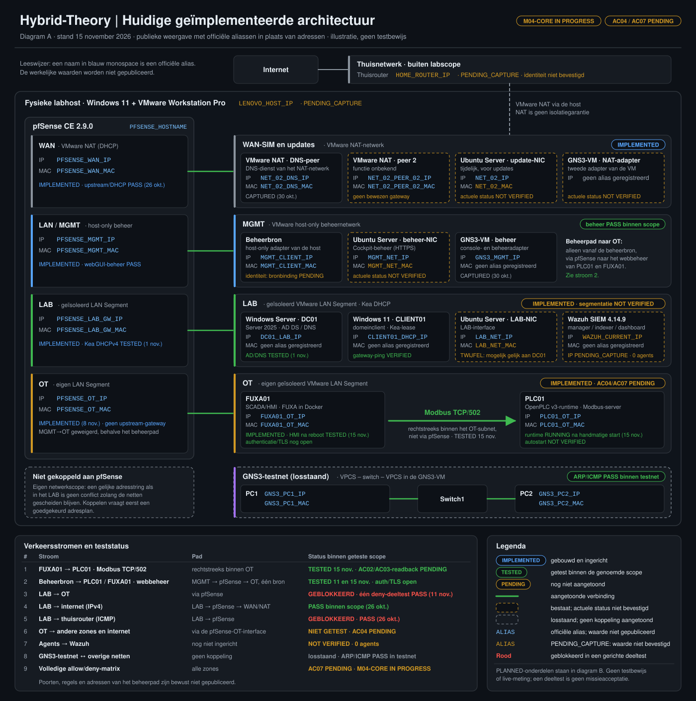
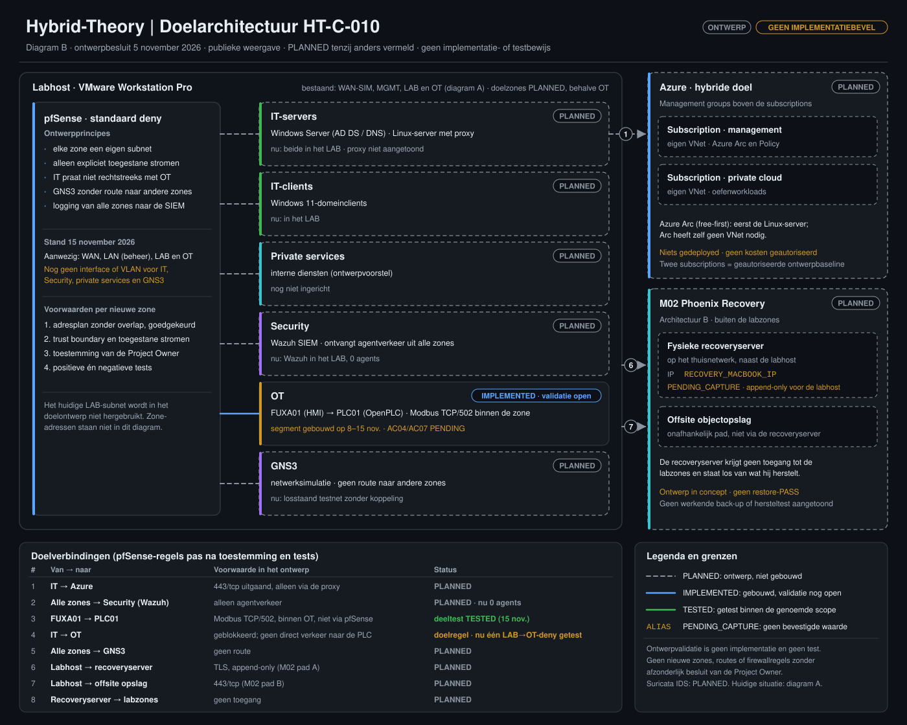

# Architectuur | Hybrid-Theory

**Bijgewerkt:** 15 november 2026 · **Bron:** private architectuur, stand 15 november 2026 · **Weergave:** gesaneerd, met officiële aliassen.

Deze map beschrijft de netwerkarchitectuur van het Hybrid-Theory-lab in twee lagen: wat er nu staat (diagram A) en waar het ontwerp naartoe gaat (diagram B). Adressen zijn vervangen door **vaste, officiële aliassen** zoals `PLC01_OT_IP`. Dezelfde alias verwijst overal naar hetzelfde adres; de werkelijke waarden en de vertaaltabel blijven privé.

## 1. Diagram A — huidige geïmplementeerde architectuur (15 november 2026)

*Figuur 1. **Architectuurillustratie**, geen testbewijs en geen live-meting. De figuur bevat geen werkelijke adressen.*

**Wat de figuur laat zien:**

- **Eén VMware-host, vier netwerken achter pfSense:** WAN-SIM (VMware NAT), MGMT (host-only beheer), LAB en OT. Alle vier zijn **IMPLEMENTED**.
- **FUXA01 praat rechtstreeks met PLC01** via Modbus TCP/502. Beide staan in hetzelfde OT-subnet, dus dit verkeer loopt niet via de pfSense-router en zegt niets over de grens naar andere zones.
- **Via pfSense lopen:** het afgebakende beheerpad van de beheerbron naar het webbeheer van PLC01 en FUXA01, LAB-verkeer naar buiten en de geblokkeerde LAB→OT-poging.
- **Het GNS3-testnet staat los** van pfSense en het thuisnetwerk.
- **M04-CORE is IN PROGRESS:** AC04 (integrale segmentatie) en AC07 (volledige allow/deny-matrix) zijn **PENDING**.

De verkeersstromen met hun teststatus staan in [Netwerkontwerp §1.1](NETWERKONTWERP.md#11-huidige-verkeersstromen-stand-15-november-2026).

### 1.1 Componenten, zones en officiële aliassen

| Component | Zone / netwerk | IP-alias | MAC-alias | Status |
|---|---|---|---|---|
| pfSense WAN | WAN-SIM (VMware NAT) | `PFSENSE_WAN_IP` | `PFSENSE_WAN_MAC` | **IMPLEMENTED** |
| pfSense LAN / MGMT | MGMT (host-only) | `PFSENSE_MGMT_IP` | `PFSENSE_MGMT_MAC` | **IMPLEMENTED**; webbeheer PASS binnen scope |
| pfSense LAB | LAB | `PFSENSE_LAB_GW_IP` | `PFSENSE_LAB_GW_MAC` | **IMPLEMENTED**; Kea DHCPv4 TESTED (1 nov.) |
| pfSense OT | OT | `PFSENSE_OT_IP` | `PFSENSE_OT_MAC` | **IMPLEMENTED** (8 nov.); geen upstream-gateway |
| PLC01 (OpenPLC) | OT | `PLC01_OT_IP` | `PLC01_OT_MAC` | **IMPLEMENTED**; runtime en Modbus TCP/502 TESTED (15 nov.) |
| FUXA01 (SCADA/HMI) | OT | `FUXA01_OT_IP` | `FUXA01_OT_MAC` | **IMPLEMENTED**; HMI en Modbus-verbinding TESTED (15 nov.) |
| Windows Server 2025 (DC01) | LAB | `DC01_LAB_IP` | geen alias | AD DS/DNS TESTED (1 nov.); adres **TWIJFEL** |
| Windows 11 (CLIENT01) | LAB | `CLIENT01_DHCP_IP` | geen alias | DHCP-lease; domeinclient TESTED (1 nov.) |
| Ubuntu Server, LAB-interface | LAB | `LAB_NET_IP` (IPv6: `LAB_NET_IPV6_LL`) | `LAB_NET_MAC` (PENDING_CAPTURE) | adres **TWIJFEL** |
| Ubuntu Server, beheerinterface | MGMT | `MGMT_NET_IP` (IPv6: `MGMT_NET_IPV6_LL`) | `MGMT_NET_MAC` (PENDING_CAPTURE) | Cockpit PASS (25 okt.); actuele status **NOT VERIFIED** |
| Ubuntu Server, update-interface | WAN-SIM | `NET_02_IP` (IPv6: `NET_02_IPV6_LL`) | `NET_02_MAC` (PENDING_CAPTURE) | tijdelijk; actuele status **NOT VERIFIED** |
| Wazuh SIEM | LAB | `WAZUH_CURRENT_IP` (PENDING_CAPTURE) | geen alias | dashboard TESTED (3–4 nov.); 0 agents |
| GNS3-VM, beheer | MGMT | `GNS3_MGMT_IP` | geen alias | beheer bereikbaar |
| GNS3 VPCS PC1 / PC2 | GNS3-testnet (losstaand) | `GNS3_PC1_IP` / `GNS3_PC2_IP` | `GNS3_PC1_MAC` / `GNS3_PC2_MAC` | ARP/ICMP PASS binnen het testnet |
| Beheerbron | MGMT | `MGMT_CLIENT_IP` | `MGMT_CLIENT_MAC` | identiteit nog te bevestigen |
| VMware NAT, DNS-peer en tweede peer | WAN-SIM | `NET_02_DNS_IP` / `NET_02_PEER_02_IP` | `NET_02_DNS_MAC` / `NET_02_PEER_02_MAC` | functie tweede peer onbekend |
| Fysieke labhost | thuisnetwerk | `LENOVO_HOST_IP` (PENDING_CAPTURE) | geen alias | — |
| Thuisrouter | thuisnetwerk | `HOME_ROUTER_IP` (PENDING_CAPTURE) | geen alias | identiteit niet bevestigd |
| Recoveryserver (M02) | thuisnetwerk | `RECOVERY_MACBOOK_IP` (PENDING_CAPTURE) | geen alias | **PLANNED** |

**Leesregels:**

- De tabel bevat alleen aliasnamen. **PENDING_CAPTURE** betekent dat er geen bevestigde waarde is; er is niets ingevuld of geschat. Waar "geen alias" staat, bestaat geen officiële alias.
- **TWIJFEL:** `LAB_NET_IP` en `DC01_LAB_IP` zijn op verschillende meetdatums met dezelfde waarde vastgelegd. Gelijktijdig gebruik is niet aangetoond; dit is geen bewezen conflict.
- `PFSENSE_LAB_GW_IP` en `GNS3_PC1_IP` hebben dezelfde waarde in **gescheiden netwerken**. Dat wordt pas een conflict als die netwerken worden gekoppeld.
- `PLC01_TEMP_NAT_IP` en `FUXA_TEMP_NAT_IP` zijn **historische** adressen van vóór de OT-migratie en geen actuele endpoints.
- **TESTED** betekent: getest binnen de genoemde scope en vastgelegd in een gedateerd log. De primaire evidence is niet gepubliceerd.

## 2. Diagram B — doelarchitectuur HT-C-010

*Figuur 2. **Ontwerpillustratie** van de op 5 november 2026 door Sam gevalideerde doelarchitectuur (HT-C-010). Dit is een ontwerpbesluit, geen implementatie en geen test.*

- **Bestaande netwerken (diagram A):** WAN-SIM, MGMT, LAB en OT zijn **IMPLEMENTED**.
- **HT-C-010-doelzones:** van de zes doelzones bestaat alleen OT al als eigen segment. IT-servers, IT-clients, Security, private services en GNS3 zijn als afzonderlijke zones **PLANNED**; hun systemen staan nu in het LAB of in het losstaande GNS3-testnet.
- **Azure:** de ontwerpbaseline bevat **twee** voorgestelde subscriptions, elk met een eigen VNet. Niets is gedeployed. **PLANNED.**
- **M02 Phoenix Recovery:** recoveryserver buiten de labzones en een onafhankelijk offsite-pad. Geen restore getest. **PLANNED.**

De doelverbindingen staan in [Netwerkontwerp §2](NETWERKONTWERP.md#2-ht-c-010-doelarchitectuur-en-toekomstige-netwerkgrenzen).

## 3. Huidige en geplande onderdelen

| Onderdeel | Bewezen basis | Doel / resterende validatie |
|---|---|---|
| VMware en pfSense | Host met meerdere VM's; pfSense met vier interfaces (WAN, MGMT, LAB, OT); gerichte LAB-, DHCP- en firewallproeven | Integrale segmentatie (AC04) en volledige allow/deny-matrix (AC07) |
| Windows Server en Windows 11 | AD DS, DNS/SRV, domain join, testlogin en GPO binnen afgebakende scope | Hardening, redundantie en herstelbaarheid |
| Ubuntu en Cockpit | Linuxbeheer en beperkte beheertoegang getest | Actuele interfacestatus, private services, optionele Azure Arc-agent |
| Wazuh SIEM | Manager/indexer/dashboard gestart, dashboardlogin bereikt | Agentingestie (nu 0 agents), detectie en een eigen Security-zone |
| GNS3 en Wireshark | Gescheiden VPCS-switch-test met ARP/ICMP | Uitgebreid netwerk, isolatie en routevalidatie |
| FUXA01 en PLC01 (OT) | Beide in het OT-segment; OpenPLC-runtime draait na handmatig starten; Modbus TCP/502 en de FUXA-verbinding getest (15 nov.) | Volledige AC02/AC03-readback-evidence, autostart van de runtime, authenticatie/TLS en OT-isolatie |
| Phoenix Recovery M02 | Architectuur B ontworpen | Onafhankelijke recoveryhost, offsite en restoretest |
| Azure / Entra / Arc | Architectuurvoorstel | Twee afzonderlijke subscriptions/VNets, kostenreview en deployment |

**Bewijsregel:** een geïnstalleerde VM of werkend dashboard is niet automatisch een voltooide securitycontrole. Losse tests gelden alleen binnen hun gedocumenteerde scope.

## 4. Netwerkgrenzen en onzekerheid

De bestaande netwerken WAN-SIM, MGMT, LAB en OT worden uitdrukkelijk **gescheiden** van de geplande IT-, Security-, private-services- en GNS3-zones. De OT-zone is gebouwd, maar haar isolatie is **niet bewezen** zolang AC04 en AC07 openstaan. Een geslaagde verbinding binnen OT is geen bewijs van afscherming naar andere zones.

[Netwerkontwerp](NETWERKONTWERP.md) beschrijft de huidige stromen, de doelverbindingen en de openstaande verificaties. De figuren bevatten geen werkelijke adressen, geen firewall- of NAT-configuratie en geen beheerdetails.

## 5. Historische figuur

De [publieke figuur van 5 november 2026](diagrammen/HT-NETWERKARCHITECTUUR-PUBLIC-2026-11-05.svg) blijft als historische weergave bewaard. Ze dateert van vóór de OT-migratie, toont OpenPLC nog als gepland en gebruikt aliasnamen die niet de officiële zijn. Gebruik voor de actuele situatie diagram A en B.

## 6. Documentatie en governance

- [Architectuurbaseline / CAT/ACE v0.4](ARCHITECTUUR_BASELINE.md)
- [Netwerkontwerp en trust boundaries](NETWERKONTWERP.md)
- [pfSense-plan](PFSENSE_PLAN.md)
- [Linux/Cockpit](LINUX_COCKPIT_SERVICE.md)
- [Azure free-first doelontwerp](VOORBEELDMODEL-HYBRIDE-TOPOLOGIE-AZURE-GRATIS.md)
- [M02 Phoenix Recovery](../governance/M02-Phoenix-Recovery/README.md)

**Publicatiegrens:** deze figuren en tabellen zijn gesaneerd; een volledige review van repo-historie, issues en alle artifacts blijft een aparte controle. Zie het [publicatiebeleid](../governance/PUBLICATIEBELEID.md).
