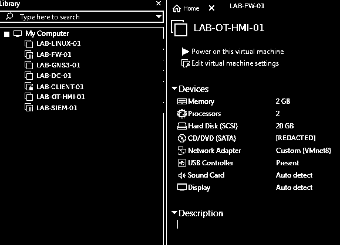

# FUXA | OT/HMI-simulatie — publieke bewijsvoering

**Status 4 november 2026:** FUXA draait volgens het separate interne installatielog met een vanaf de host bereikbare webeditor, maar dit openbare bewijsbestand betreft uitsluitend een **VMware-hardware-inventarisatie**. PLC-integratie, Modbus, authenticatie/TLS en OT-isolatie zijn **niet** aangetoond.

## VMware-overzicht

**Vastgelegd:** VM uitgeschakeld, 2 GB geheugen, 2 processors, 20 GB SCSI, Custom (VMnet8). Host-/VM-identificatoren en lokaal ISO-pad gesanitized. Geen ongeanonimiseerde screenshot gepubliceerd. Zie de [VMware-bewijsindex](../VMware/README.md).
