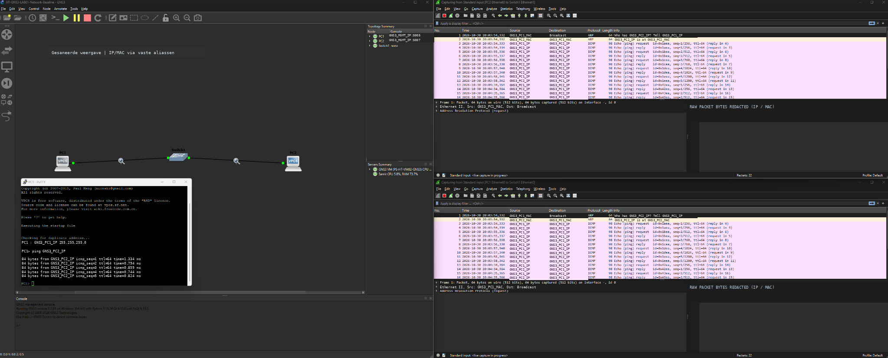
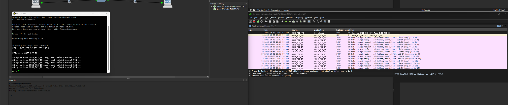
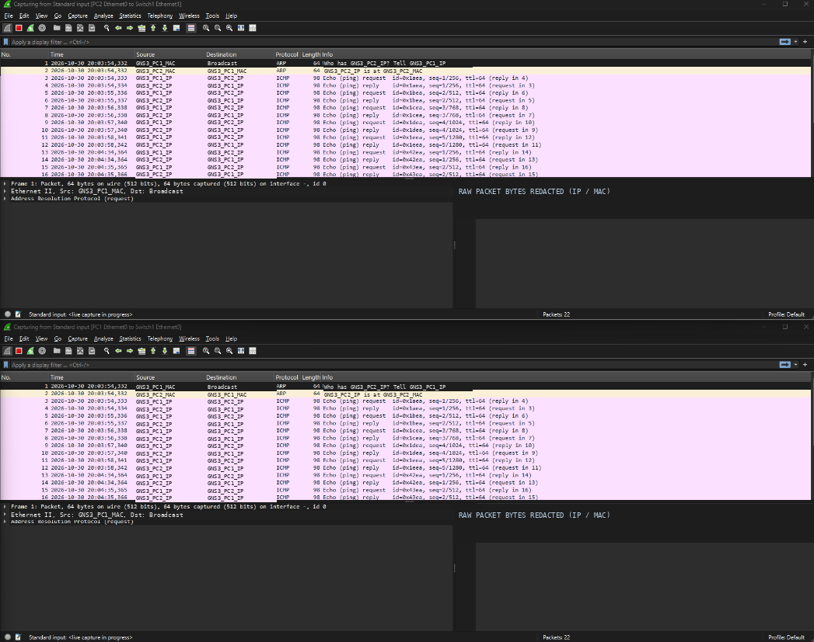

# GNS3 LAB01 — netwerksimulatie en ARP/ICMP

De GNS3-basisopstelling bestaat uit twee virtuele VPCS-clients via een Ethernet-switch. De aangetoonde ARP- en ICMP-connectiviteit is **PASS binnen deze beperkte testscope**. Reproduceerbaarheid, tijdsynchronisatie, pfSense-koppeling en uitgebreide isolatie blijven **PENDING/PARKED** naar hun bestaande werkstatus.

## 1. LAB01 — netwerkoverzicht

De gecombineerde GNS3-/Wireshark-weergave toont de testtopologie en de waargenomen pakketuitwisseling.

## 2. LAB01 — detailweergave

Detailbeeld van de virtuele clients, switch en packetcapture. **Huidige zichtbaarheid: PUBLIC.** Aanvullende visuele controle op labels is nog nodig.

## 3. Wireshark — ARP/ICMP-packetanalyse

De reeds gesaneerde capture maakt de geobserveerde communicatie inzichtelijk.

**Let op:** screenshots bewijzen geen volledige netwerkisolatie, firewallwerking of een productiegeschikte securityarchitectuur. Deze beelden zijn al publiek zichtbaar, terwijl volledige privacy-/pixelreview nog niet is afgerond. Dat is geen publicatie-PASS.

**Statusgebruik:** [statuslegenda](../../governance/STATUSLEGENDA.md).
