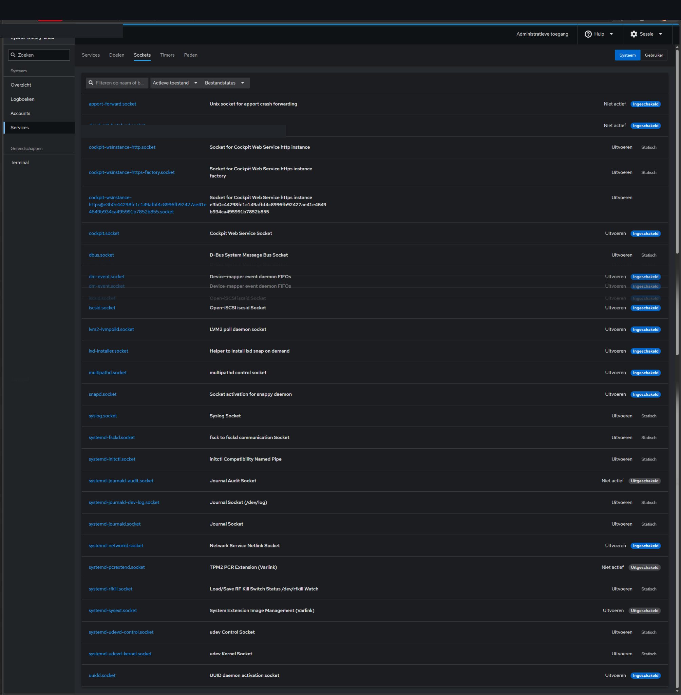
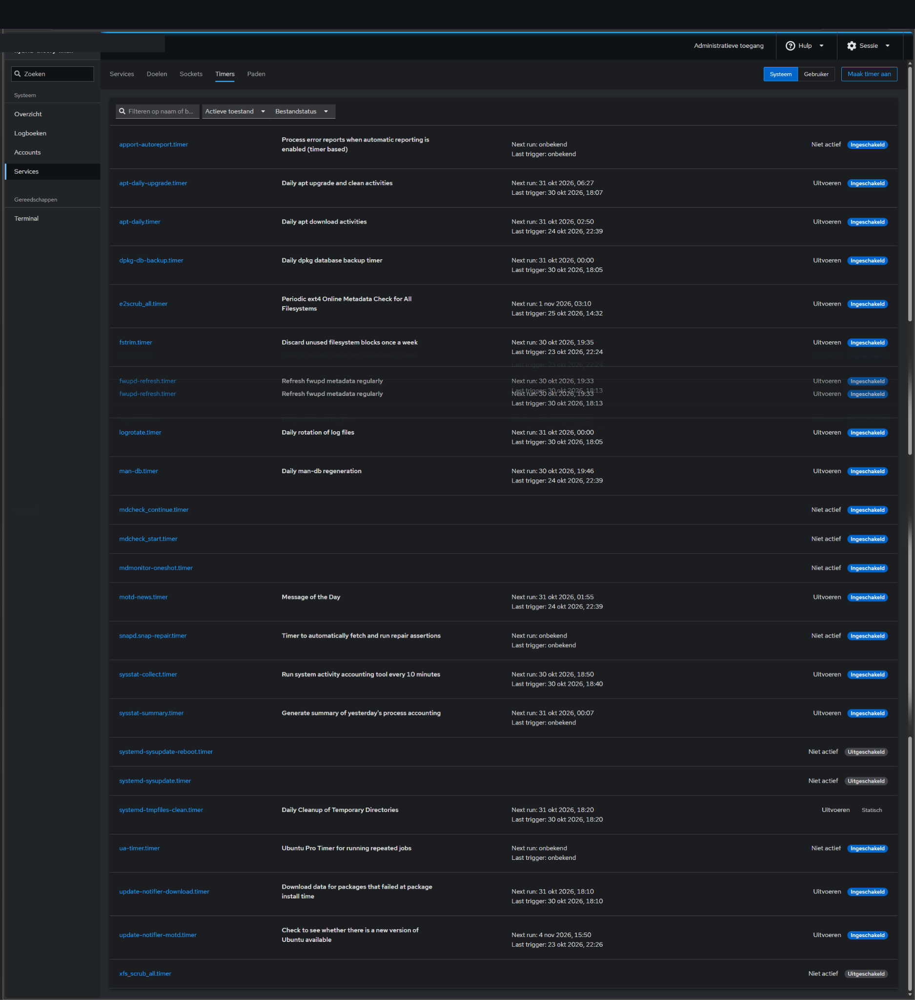
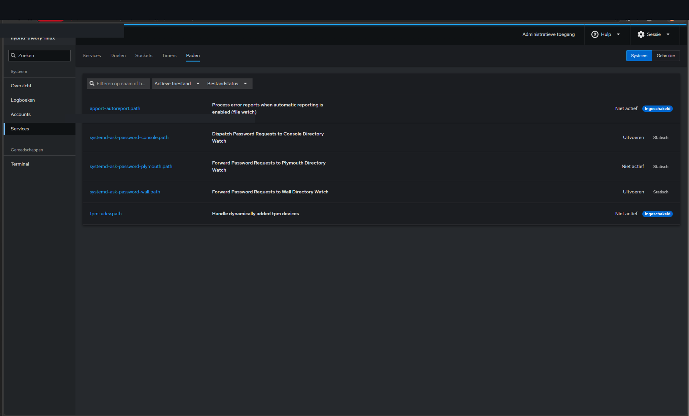
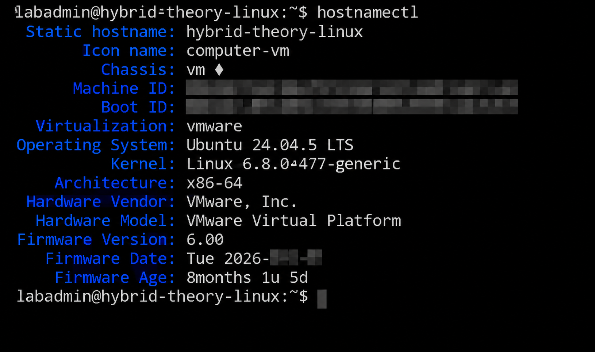

# Ubuntu Linux | Cockpit en systeeminventaris

Ubuntu Server en Cockpit zijn in het lab operationeel. De beelden hieronder zijn **historische momentopnamen** van de configuratie en geen continue monitoring of algemene security-PASS.

## 1. Cockpit — Sockets

Systemd-sockets en hun ingeschakelde toestand op het observatiemoment.

## 2. Cockpit — Timers

Actieve of geconfigureerde timers, waaronder periodieke onderhoudstaken.

## 3. Cockpit — Paths

Systemd path-units met statussen zoals weergegeven tijdens de sessie.

## 4. Linux — Systeeminformatie

De `hostnamectl`-weergave toont de virtuele Ubuntu-omgeving. Unieke machine- en boot-ID's waren in het bronbeeld al afgeschermd. **Aanvullende beeldcontrole blijft noodzakelijk, hoewel GitHub deze afbeelding al publiek toont.**

---

**Nog ontbrekend wegens technische overdrachtslimiet:** `01-Cockpit-Overzicht.png`, `05-Linux-Netwerkbeheer.png` en `06-Linux-Netwerkinterfaces.png`. Deze drie grote PNG's konden niet via de huidige GitHub-connector worden gedownload en zijn niet via de galerij gekoppeld.

**Publicatie:** repository is nu PRIVATE (eerder PUBLIC), terwijl beeld-/identifierscans nog OPEN zijn. De beelden bewijzen geen volledige netwerkrol- of afhankelijkheidsvalidatie.

**Statusgebruik:** [statuslegenda](../../governance/STATUSLEGENDA.md).
