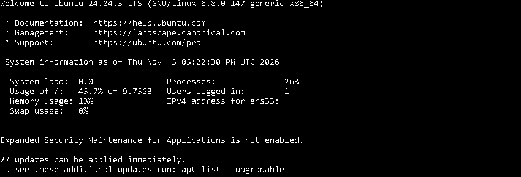
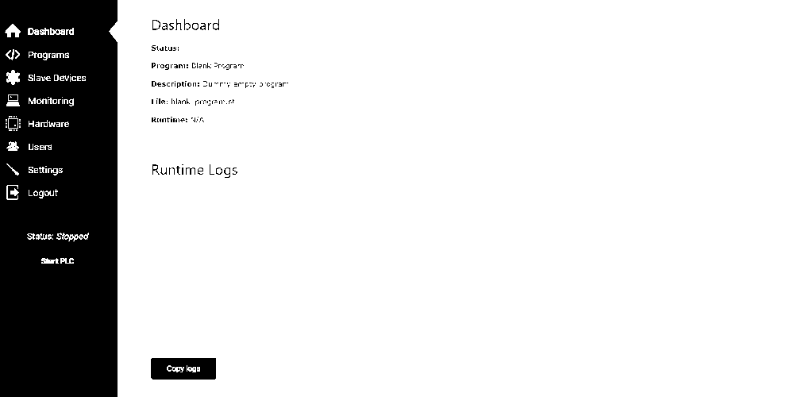
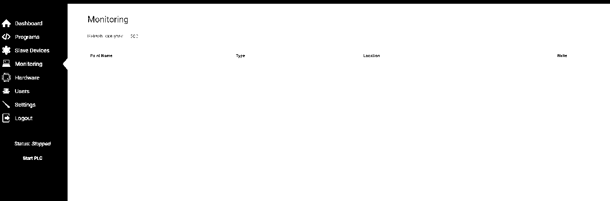
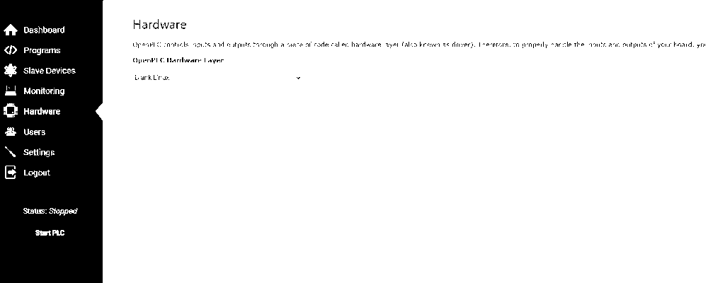
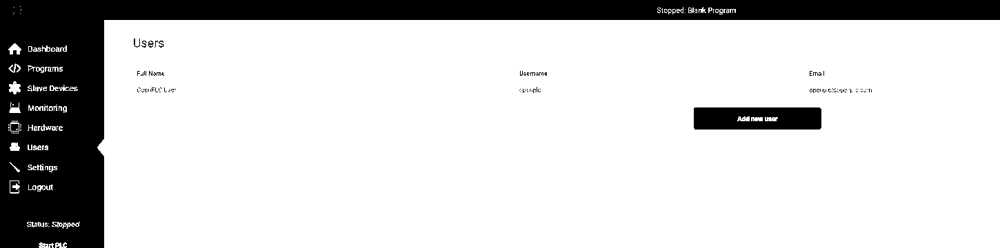
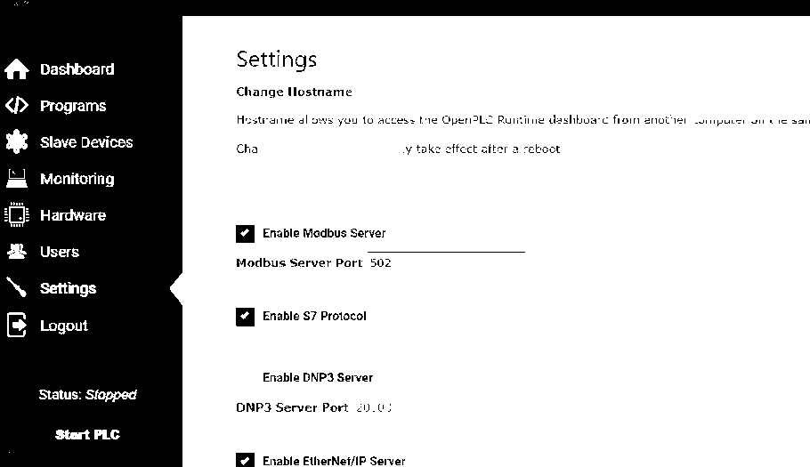

# OpenPLC | OT Runtime — bewijsvoering

**Datum:** 5 november 2026  
**Werkpakket:** M04 Network Citadel · OpenPLC-baseline  
**Bewijsbron:** door projecteigenaar aangeleverde screenshots; afgeleide, gesaneerde publicatieversies.  
**Status:** **IMPLEMENTED / WEB-UI REACHABILITY PASS (beperkte scope)**. PLC Runtime is in de getoonde sessie **Stopped: Blank Program**. FUXA-koppeling, Modbus-data, PLC-programma-uitvoering, firewallisolatie en OT-security-acceptatie zijn **NIET aangetoond**.

## Bewijsgalerij

### 1. Ubuntu OpenPLC Console
Ubuntu 24.04.5 LTS: console-login, kernel en systeeminformatie zichtbaar. Het private IP-adres en de accountidentiteit zijn afgeschermd. **OS-LOGIN CAPTURED**; geen beveiligingsacceptatie.

### 2. OpenPLC Dashboard
De OpenPLC Runtime-webinterface is bereikbaar. Status **Stopped**, programma **Blank Program** en lege Runtime Logs. **WEB-UI REACHABILITY PASS**, PLC-uitvoering **NOT VERIFIED**.

### 3. OpenPLC Programs
Programmalijst met Blank Program en webserver_program plus uploadfunctie. De aanwezigheid van bestanden is geen bewijs dat eigen PLC-logica draait. **CAPTURED**.

### 4. OpenPLC Monitoring
Monitoringpagina met lege puntentabel, zonder proceswaarden of live tags. **CAPTURED / DATA FLOW PENDING**.

### 5. OpenPLC Slave Devices
Slave Devices-pagina zonder aangesloten apparaten. **CAPTURED / DEVICE INTEGRATION PENDING**.

### 6. OpenPLC Hardware
Hardwarelaag staat op **Blank Linux**. Dit toont de basisinstelling, niet werkende fysieke I/O. **CAPTURED**.

### 7. OpenPLC Users
Gebruikersbeheer met de standaard OpenPLC-gebruiker zichtbaar; geen wachtwoorden in beeld. Authenticatie-hardening en rechtenmatrix **NOT VERIFIED**.

### 8. OpenPLC Settings
Modbus Server aangevinkt met **TCP/502**; S7 en EtherNet/IP eveneens aangevinkt; DNP3 uit. Dit toont **UI-CONFIG CAPTURED**, niet poortbereikbaarheid, veilige protocolconfiguratie of werkende Modbus-communicatie.

## Feitelijke conclusie

Op Ubuntu Server 24.04.5 LTS is een vanaf de beheercomputer bereikbare OpenPLC Runtime-webinterface vastgelegd. De pagina's Dashboard, Programs, Monitoring, Slave Devices, Hardware, Users en Settings zijn zichtbaar. Er draait op de vastgelegde momenten **geen werkend PLC-programma**. Er zijn geen actieve tags of aangesloten slaves aangetoond.

### Veiligheidswaarnemingen en vervolg

- Het Settings-scherm toont **Modbus TCP/502**, **S7** en **EtherNet/IP** als ingeschakeld. Of alle services luisteren of van buiten bereikbaar zijn, is niet getest. Schakel onnodige protocollen uit vóór een uitgebreidere netwerkverbinding.
- De getoonde webtoegang gebruikt **HTTP**. Binnen het gecontroleerde lab is dit een bekende openstaande control; publiceer de interface niet op internet en behandel netwerkisolatie, accountbeveiliging en versleuteld beheer als vervolgwerk.
- Voor de FUXA-koppeling moeten een eenvoudig PLC-programma, een testtag, een positieve Modbus-read/write-test en een negatieve firewalltoegangstest afzonderlijk worden uitgevoerd en vastgelegd.
- De schermen bewijzen **geen** IEC 62443- of ISO 27001-conformiteit.

## Sanitisatie en bewijsintegriteit

Browser-adresbalken, lokale IP-adressen, hostname- en accountidentificatoren zijn afgesneden of onomkeerbaar afgedekt. De screenshots zijn waar nodig beperkt tot de bewijsrelevante inhoud en als monochrome PNG geëxporteerd om omvang en ongewenste UI-context te verminderen. **Geen synthetische meetwaarden of extra testresultaten toegevoegd.** Originele onbewerkte beelden zijn niet in de repositories opgenomen.

**Statusmodel:** CAPTURED = beeld aanwezig · IMPLEMENTED = component geïnstalleerd · PASS = uitsluitend de geteste scope · PENDING = niet bewezen. Zie [bewijsindex](../README.md).
