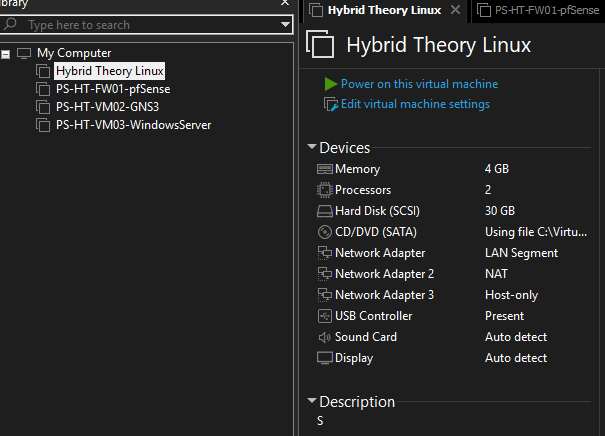
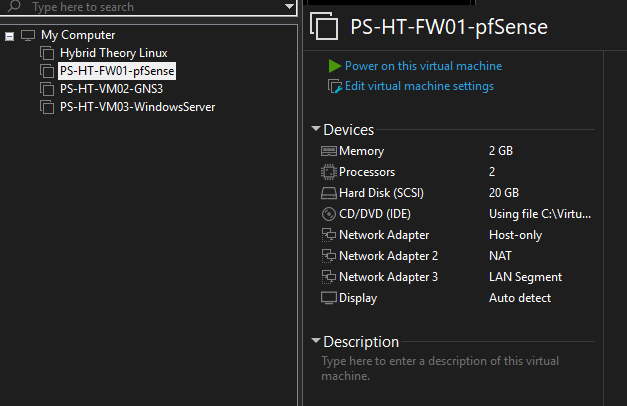
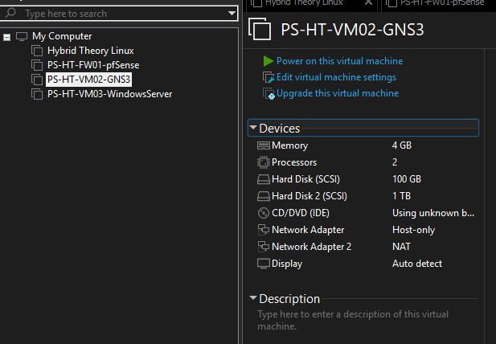
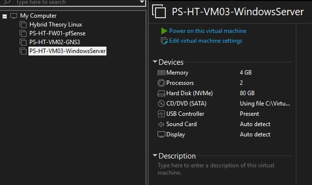
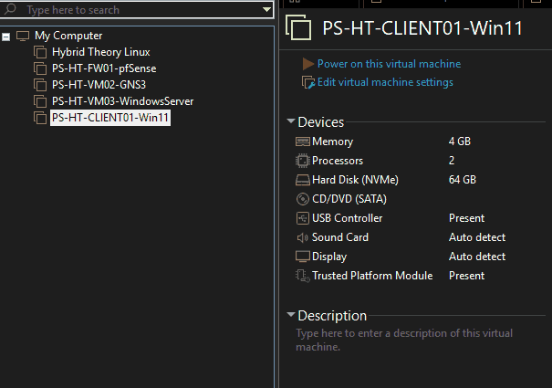
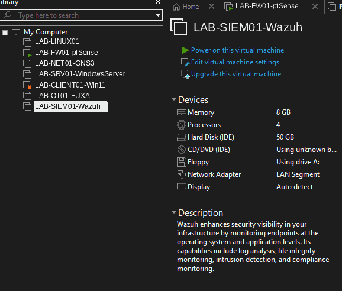
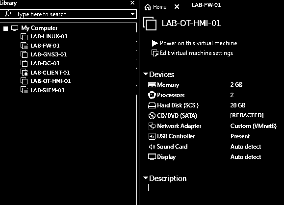
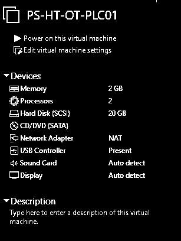

# VMware | Virtuele infrastructuur

**Status:** historische inventaris van de aanwezige VM's en hun virtuele resources. Deze beelden tonen geen volledige securitybaseline; lokale mediapaden zijn in enkele oude screenshots gedeeltelijk zichtbaar. **PUBLIC; pixel- en identificatorreview OPEN.**

## 1. Ubuntu Server

Ubuntu-VM, resourceprofiel en meerdere virtuele netwerkadapters.

## 2. pfSense Firewall

VM-configuratie en verschillende adapterrollen voor pfSense.

## 3. GNS3

GNS3-VM met geheugen, processor- en netwerkadapterinstellingen.

## 4. Windows Server

Windows Server 2025-VM met virtuele hardware.

## 5. Windows 11 Client

Windows 11-VM met geheugen, CPU en virtuele opslag.

## 6. Wazuh | VMware-hardwareconfiguratie

Gesanitized VMware-screenshot van de Wazuh-VM (SIEM/XDR) met **8 GB RAM, 4 virtuele processors, 50 GB schijfruimte** en een netwerkadapter op **LAN Segment**. De VM staat uit op het moment van vastlegging. VM-namen zijn vervangen door generieke LAB-aliassen; de oorspronkelijke hardwarewaarden zijn behouden. **Bewijsstatus: CAPTURED** (VM-inventarisatie, geen bewijs van werkende detectie, agentcommunicatie, netwerkisolatie of securityhardening).

---

**Publicatierisico:** deze afbeeldingen staan reeds **PUBLIC**. Lokale ISO-/hostpaden kunnen zichtbaar zijn; onomkeerbare pixelredactie, metadatareview en controle van eerdere commits zijn nog vereist. Dit vormt geen geslaagde publicatiecontrole.

**Statusgebruik:** [statuslegenda](../../governance/STATUSLEGENDA.md).

## 8. FUXA | VM-inventaris en netwerkadapter (4 november 2026)

Sanitized momentopname van de **uitgeschakelde FUXA-VM** in VMware Workstation. De afbeelding toont **2 GB RAM, 2 processors, 20 GB SCSI-opslag**, een **Custom (VMnet8)**-netwerkadapter en aanwezige USB-, audio- en displaydevices. Het gemonteerde ISO-pad en de VM-/hostlabels zijn vervangen door onherleidbare LAB-aliassen. De overige hardwarewaarden zijn **niet gewijzigd**.

**Evidence:** CAPTURED / hardware-inventarisatie. De VM staat op dit vastlegmoment **uit**. Dit beeld bewijst geen werkende FUXA-webinterface, PLC/Modbus-integratie, firewallisolatie of security-hardening. **VMnet8 is een VMware-netwerkselectie, geen bewijs van OT-segmentatie.**

## 9. OpenPLC | VMware-hardware-inventaris (5 november 2026)

Gesaneerde momentopname van de virtuele machine `PS-HT-OT-PLC01` in VMware Workstation. Zichtbaar op het moment van vastlegging: **2 GB RAM, 2 processors, 20 GB SCSI-opslag** en één netwerkadapter op **NAT**. De VM staat **uit** (VMware toont *Power on this virtual machine*). De overige VM-inventaris is buiten beeld gelaten en het lokale CD/DVD-/ISO-pad is onomkeerbaar afgeschermd. Het beeld is voor compacte en veilige publicatie in zwart-wit opgeslagen; de getoonde resourcewaarden zijn niet gewijzigd.

**Bewijsstatus: CAPTURED / configuratie-inventarisatie.** De opname bewijst dat de VM als object met deze virtuele resources bestaat, **niet** dat OpenPLC Runtime werkt, dat PLC-/Modbus-verkeer plaatsvindt, dat FUXA gekoppeld is of dat netwerkisolatie en hardening zijn gevalideerd. **NAT is geen isolatiebewijs.**
