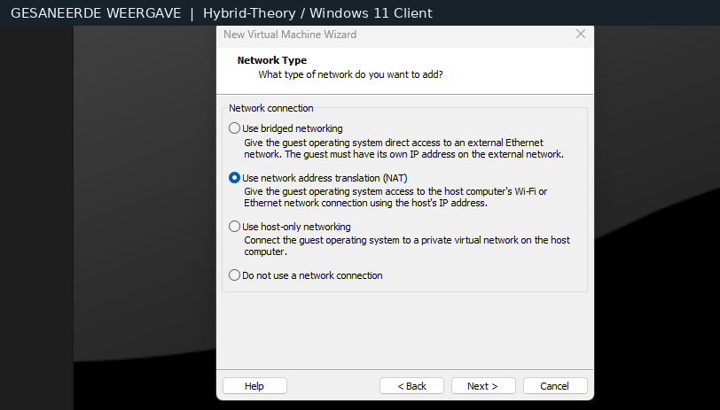
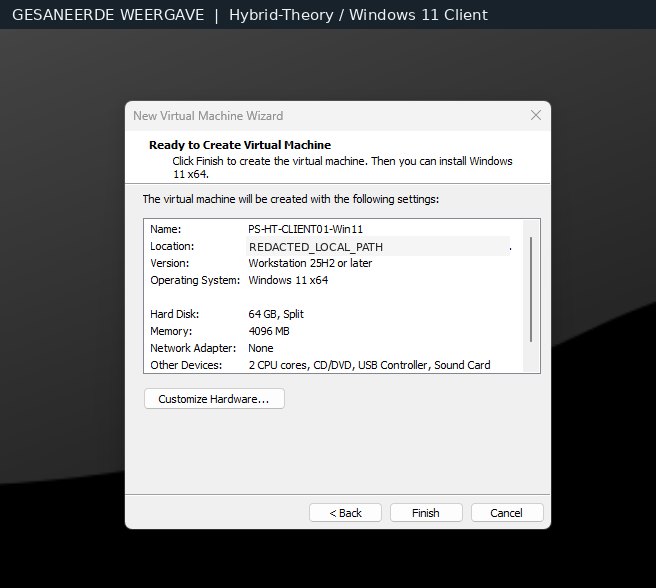
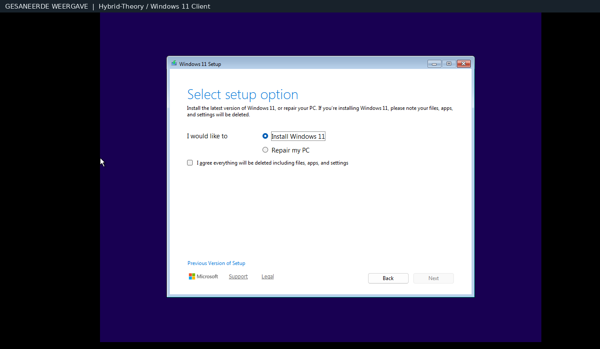
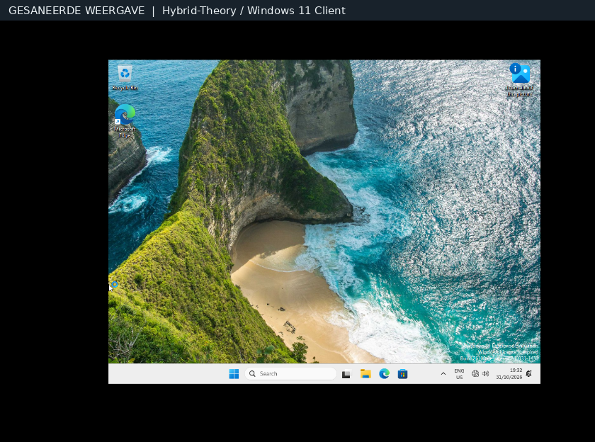
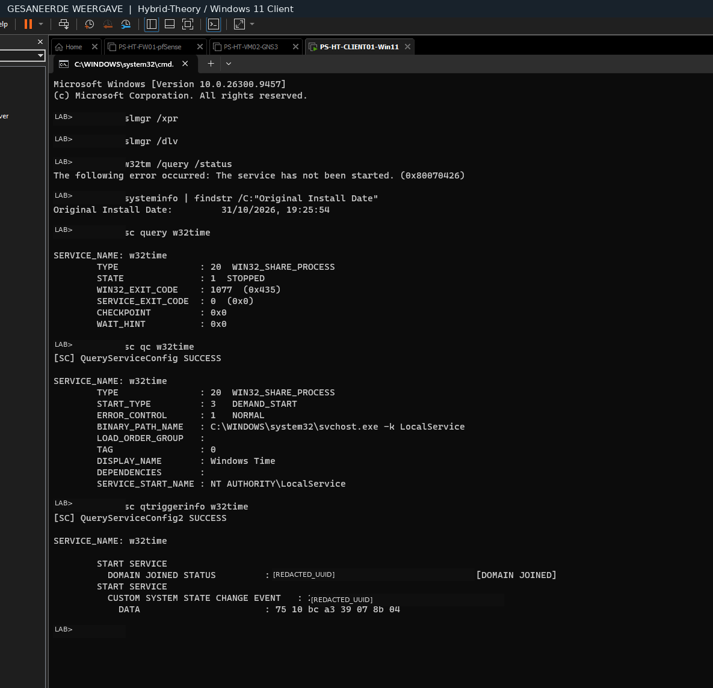
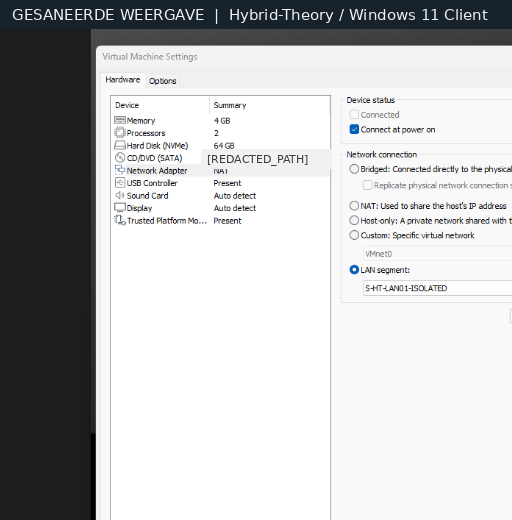
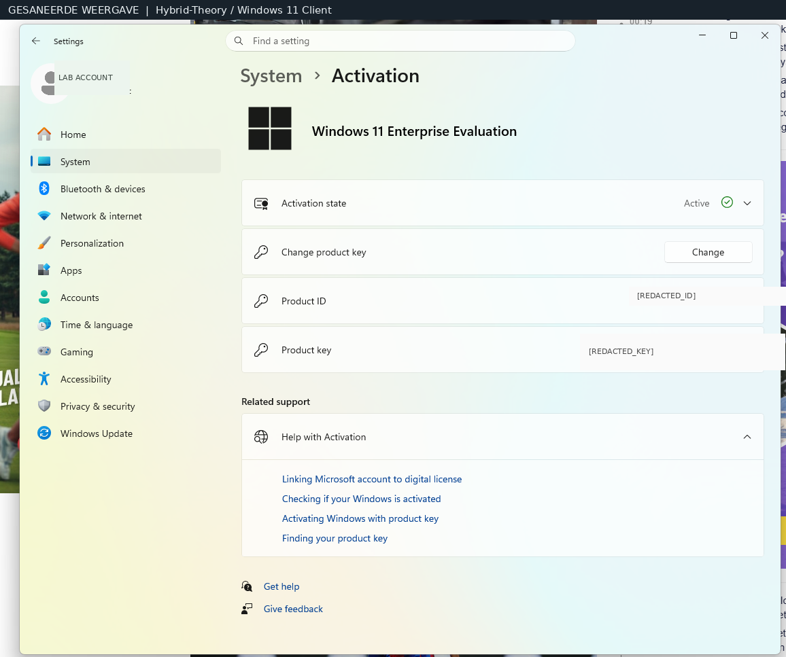
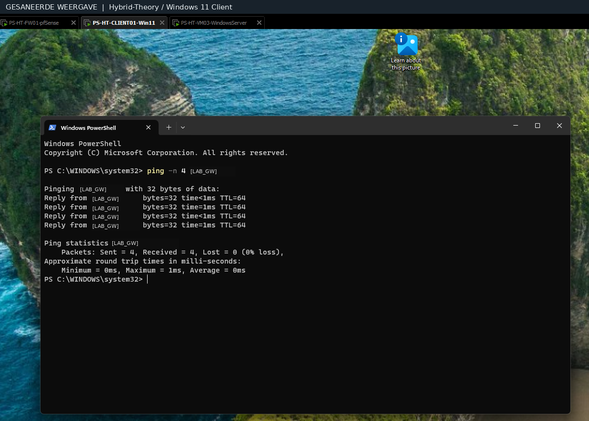

# Windows 11 Client — installatie en validatie

Gesaneerde technische screenshots van de Windows 11 Enterprise Evaluation-client. Deze historische afbeeldingen tonen afzonderlijke stappen; de latere domain join en GPO zijn aanvullend gerapporteerd.

## 1. VMware-netwerkkeuze

NAT was een wizardselectie, niet het definitieve LAB-netwerk.

## 2. VM-specificaties

Geheugen, CPU, opslag en afgeschermd hostpad.

## 3. Windows-installatie

Installatiefase van de enterprise client.

## 4. Eerste bureaublad

Bevestigt dat Windows 11 start.

## 5. Windows Time

Gerichte serviceobservatie zonder diagnoseclaim.

## 6. LAB-netwerkadapter

VMware LAN Segment geselecteerd.

## 7. Evaluatie-activatie

Activatiestatus zichtbaar, productsleutel en ID afgeschermd.

## 8. Gateway-ICMP-test

4 van 4 antwoorden binnen afgebakende testscope.

---

De screenshots bewijzen niet dat alle securitypolicies of alle segmentatiegrenzen zijn getest.

**Publicatie:** gesaneerde labweergaven. Bewijsscope en openstaande controles worden niet opgewaardeerd door de afbeelding zelf.

**Repositoryzichtbaarheid:** PUBLIC; de resterende repositorybrede publicatiegates zijn niet afgerond. Zie [statuslegenda](../../governance/STATUSLEGENDA.md).
