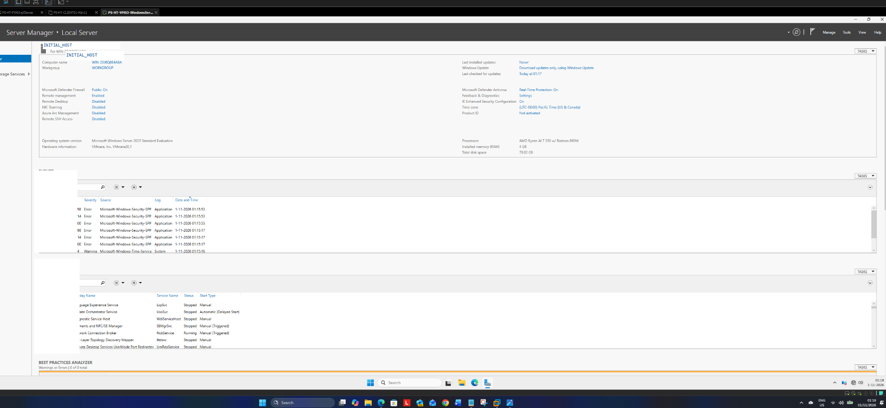
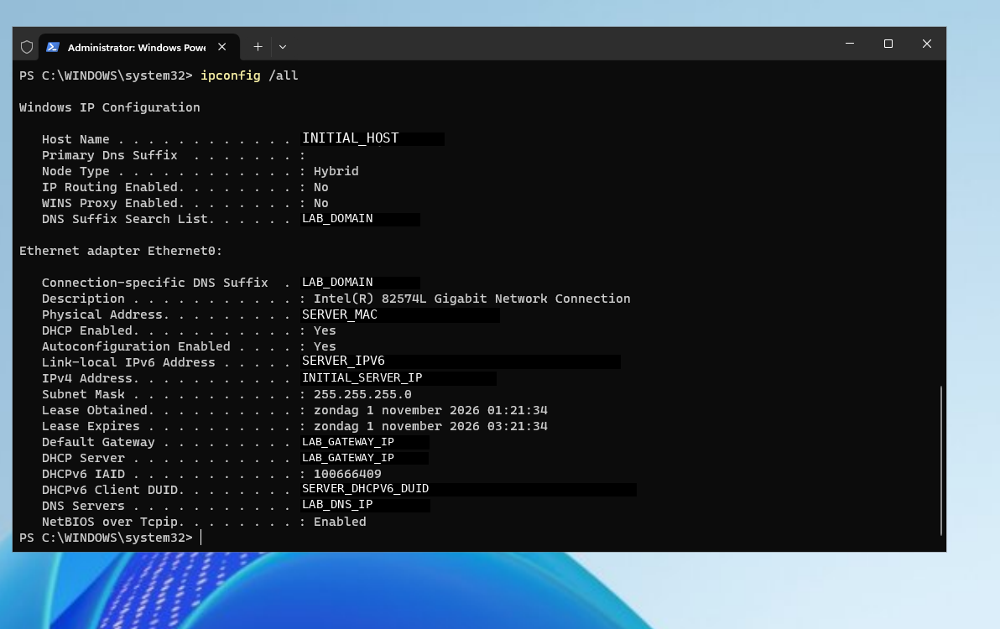
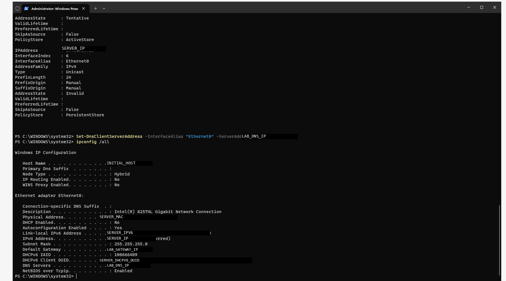
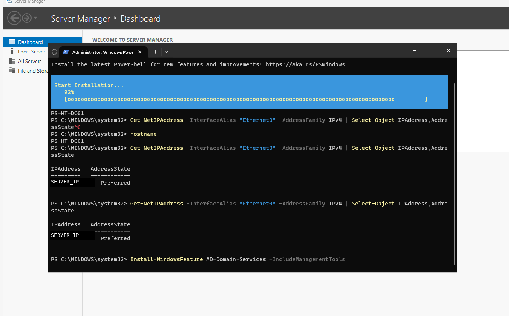
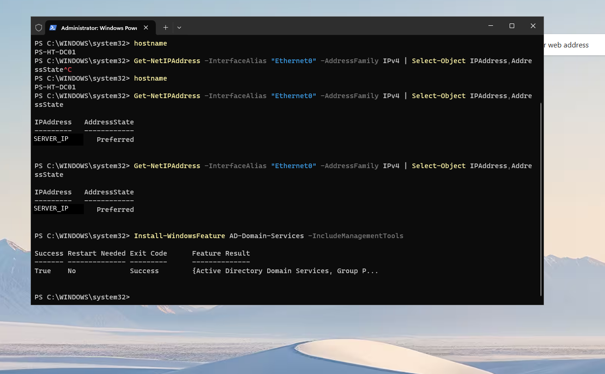

# Windows Server 2025 | Installatie en AD DS

De screenshots leggen de eerste Windows Server-installatie-, netwerk- en AD DS-roleinstallatiestappen vast. De latere forest/DC-promotie, DNS/SRV, domain join en één GPO zijn afzonderlijk beschreven in het [AD-baselinerapport](../../projectlogboeken/2026-11-01-ad-dns-domainjoin-gpo-samenvatting.md).

## 1. Eerste Server Manager-overzicht

**PUBLIC (gecontroleerd 05-11-2026) — pixelredactie OPEN:** oudere dashboardopname met een automatisch Windows-hostlabel. Niet aantoonbaar volledig geanonimiseerd.

## 2. DHCP-netwerkbaseline

Eerste netwerk- en DNS-inventaris, met reeds geabstraheerde identificatoren.

## 3. Statisch IPv4 en DNS

Tussentijdse netwerkdiagnose en configuratie. Een tijdelijke foutstatus bewijst niet dat de uiteindelijke configuratie fout bleef.

## 4. AD DS-roleinstallatie gestart

Uitvoering van de gerichte `Install-WindowsFeature`-stap.

## 5. AD DS-roleinstallatie voltooid

Succesvolle roleinstallatie. Dit is niet gelijk aan latere DC-promotie; die is apart getest.

---

**Bewijsgrens:** momentopnamen van één labserver; geen automatische claim van restore, domeinredundantie of volledige hardening. Het eerste beeld heeft nog een publicatieblokkerende privacyreview.

**Statusgebruik:** [statuslegenda](../../governance/STATUSLEGENDA.md).
