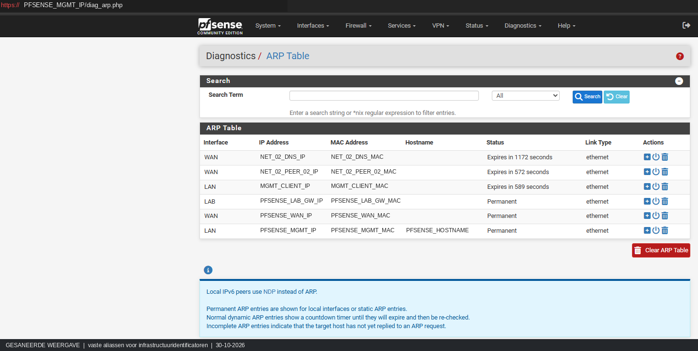
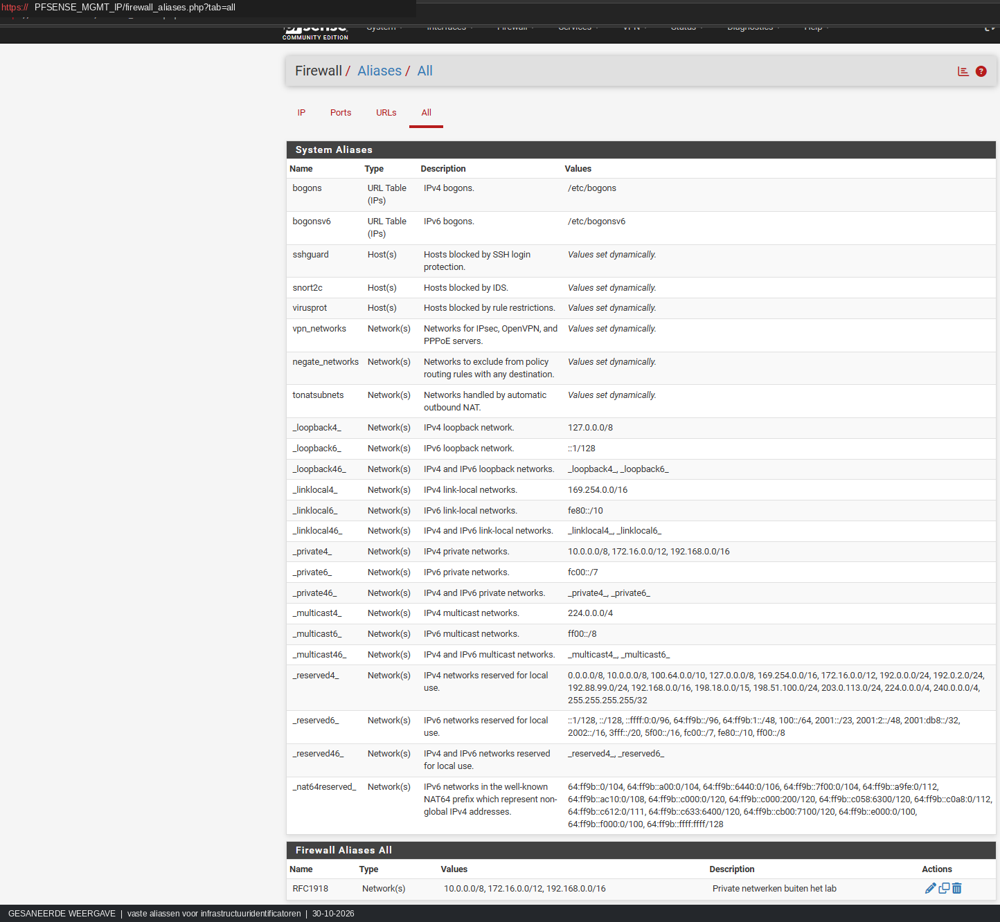
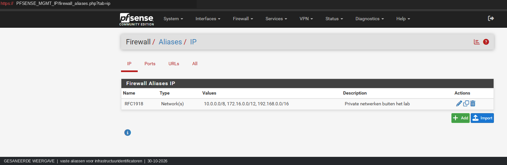
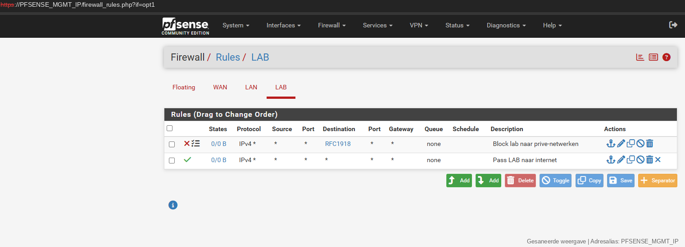
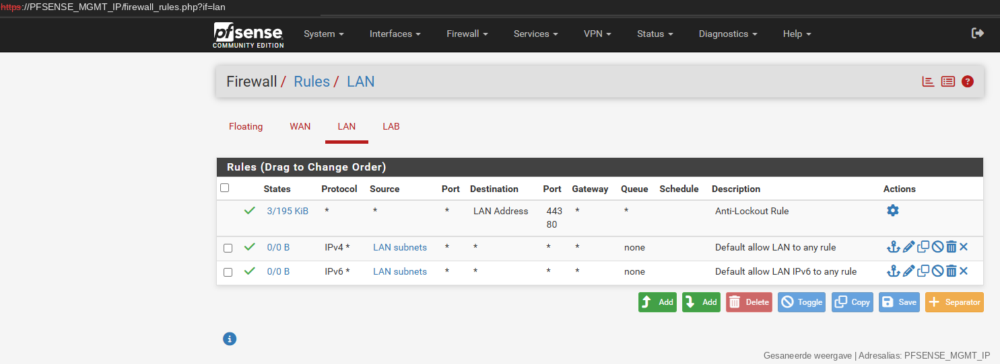
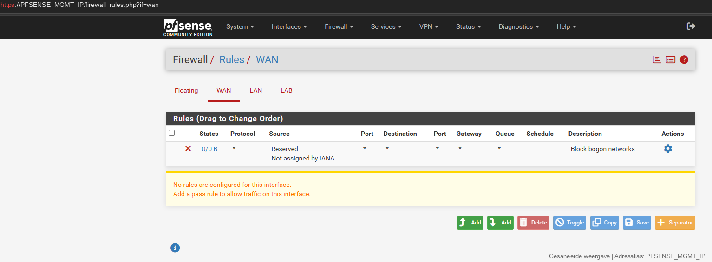

# pfSense — gesaneerde firewallbewijzen

Deze screenshots tonen de geconfigureerde netwerk- en firewallregels. Configuratiebeelden zijn geen algemene end-to-end-isolatie-PASS.

## 1. ARP Table

Adressen en MAC's vervangen door publieke aliassen.

## 2. Firewall Aliases

Systeem- en firewallaliassen in het testlab.

## 3. IP-aliases

Configuratie van IPv4/RFC1918-aliassen.

## 4. LAB firewallregels

LAB-regels en hun volgorde op het testmoment.

## 5. LAN firewallregels

Beheer-LAN-regels, geen volledige beleidsaudit.

## 6. WAN firewallregels

WAN-regeloverzicht zonder claims over alle protocollen.

---

Het grote pfSense-dashboardbeeld ontbreekt in deze repository omdat de GitHub-verbinding de bronbytes niet kon overzetten; een aanvullende visuele publicatiecontrole is eveneens nog nodig.

**Publicatie:** GitHub-zichtbaarheid **PUBLIC** (gecontroleerd 05-11-2026); volledige beeld-/identifierscan en publicatiegates zijn nog OPEN. De screenshots bewijzen uitsluitend de weergegeven configuratie binnen hun scope.

**Statusgebruik:** [statuslegenda](../../governance/STATUSLEGENDA.md).
